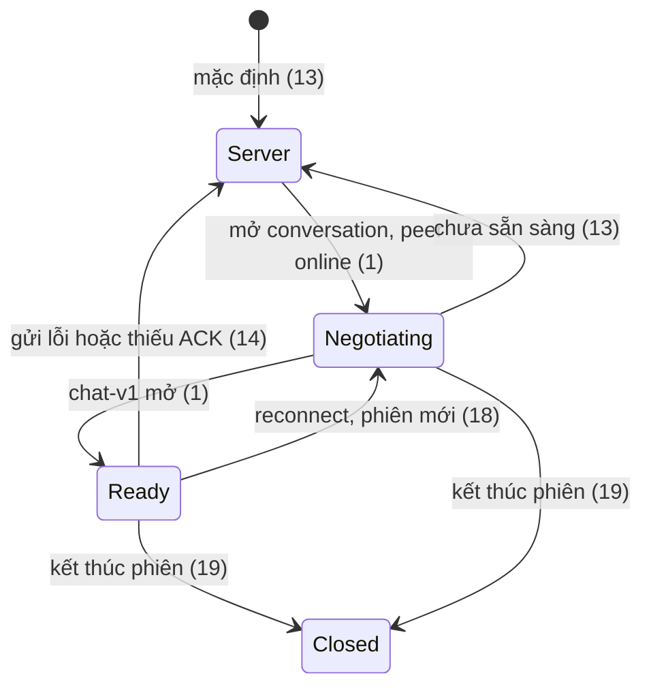

# Kế hoạch Chat text P2P Web ↔ Web

> Kế hoạch ngày 21/10/2026, người dùng đã yêu cầu triển khai. Source/tiêu chí
> được giữ để nghiệm thu; mặc định triển khai nằm ở `.checks/chat-text-p2p.md`.
> Khi triển khai dùng **tlc-implement**; mỗi criterion cần bằng chứng kiểm tra.
> Các lựa chọn trong `Unresolved` đang là đề xuất, không phải quyết định người dùng đã duyệt.

## Intent

Text hiện được `ChatHub.SendMessage` lưu SQL rồi phát qua SignalR đến các tab của hai tài khoản. WebRTC hiện chỉ dùng cho truyền file. Vì vậy hệ thống chưa chứng minh được nhắn tin text qua đường truyền P2P như kiến trúc đã mô tả.

Hai web sẽ ưu tiên giao text qua WebRTC DataChannel khi có một phiên endpoint hợp lệ; SQL vẫn giữ lịch sử. Nếu P2P chưa sẵn sàng, lỗi hoặc không có xác nhận nhận tin, hệ thống dùng SignalR với cùng ID. Phạm vi này không thêm desktop hoặc thay đổi chính sách lưu lịch sử.

24 criteria trong 6 slices · 2 ràng buộc đã có · 4 lựa chọn đề xuất, trong đó TURN thật là điều kiện để nghiệm thu khác NAT.

## Criteria

### 1. Hai tab của hai tài khoản thiết lập được phiên chat đúng người

1. Khi người dùng mở một conversation có peer online, hệ thống có thể thương lượng một phiên text P2P qua SignalR và mở DataChannel `chat-v1`, ordered/reliable.
2. Phiên có `PeerSessionId`, conversation và hai endpoint cụ thể; người ngoài conversation, tab không được ràng buộc và phiên hết hiệu lực không chuyển được SDP/ICE cho phiên đó.
3. Khi hai bên cùng bắt đầu thương lượng, chỉ một phiên cho cặp endpoint/conversation được giữ; ICE đến trước remote description được đợi và áp dụng đúng phiên.
4. Khi một tài khoản mở hai tab nhận, chỉ một tab được chọn làm endpoint P2P của phiên; các tab còn lại vẫn lấy được lịch sử/đồng bộ theo cơ chế server. Cách chọn nằm ở Unresolved 1.

### 2. Tin đi qua DataChannel, reload vẫn còn lịch sử

5. Khi gửi text hợp lệ, client tạo `ClientMessageId` một lần; server kiểm tra người gửi/thành viên và commit SQL trước khi client giao DTO qua P2P. Quy tắc chuẩn hóa và giới hạn 1–4.000 ký tự giữ như hiện tại.
6. Với tin đã chọn đường P2P, lệnh commit không phát `MessageReceived` đến endpoint nhận được chọn trước khi có cơ hội giao P2P. Endpoint đó nhận payload text qua `chat-v1`; các tab phụ vẫn được đồng bộ server, không bị mất tin.
7. Reload rồi đăng nhập lại vẫn tải được cùng tin từ API lịch sử; gửi lại cùng `(SenderId, ClientMessageId)` tạo đúng một bản ghi SQL. ID cũ với conversation hoặc nội dung khác bị từ chối như hiện tại.
8. Tin qua P2P, SignalR fallback, kết quả gửi và lịch sử đều được upsert bằng cùng danh tính tin; cùng một tin xuất hiện đúng một lần trong thread và không làm unread tăng hai lần.

### 3. Đã nhận/đã đọc phản ánh đúng tin

9. Server commit hoặc `channel.send()` thành công chỉ chứng minh đã lưu/đã gửi, không tự chuyển thành đã nhận.
10. Endpoint nhận xác thực envelope thuộc phiên, conversation và người gửi đã ràng buộc, kiểm tra kích thước/kiểu dữ liệu rồi mới nhận tin. Payload sai bị loại và không phát receipt thành công.
11. Receipt P2P phải xác nhận đúng tin thuộc conversation và tài khoản nhận; duplicate receipt có kết quả idempotent. Cách mở rộng receipt hiện tại nằm ở Unresolved 3.
12. Trong phép thử tin sau đến trước một tin trước đó, ACK/read của tin sau không đánh dấu tin chưa nhận là đã nhận/đã đọc. Đọc chỉ ghi nhận khi tin thực sự được hiển thị trong thread đang visible, theo hành vi hiện có.

### 4. P2P lỗi vẫn giao được, không trùng

13. Khi chưa có DataChannel sẵn sàng, tin dùng đường SignalR hiện có, không bắt người dùng chờ thương lượng xong mới gửi.
14. Khi đã commit nhưng P2P send lỗi hoặc hết thời gian chờ ACK, fallback giao lại tin đã commit bằng cùng ID, không thêm bản ghi. Timeout đề xuất nằm ở Unresolved 2.
15. Khi payload/ACK P2P đến muộn sau fallback, UI vẫn có đúng một tin và receipt không lùi trạng thái. Fallback và P2P dùng chung một pipeline nhận/merge.
16. Khi người nhận offline, tin được lưu và tải bù qua cơ chế server hiện có. Nếu chưa biết commit có thành công vì response mất, retry dùng cùng UUID; chưa rõ kết quả thì UI giữ chờ/lỗi, không báo đã nhận.

### 5. Đổi trang, reconnect và kết thúc phiên không gây lỗi chéo

17. Listener nhận P2P và receipt sống cùng phiên đăng nhập, không phụ thuộc trang Chat đang mount; đổi sang Tệp rồi quay lại không làm mất tin hoặc tạo listener trùng.
18. Sau reconnect có ConnectionId mới, signaling và payload của phiên endpoint cũ không được nhập vào phiên mới; client tải bù lịch sử rồi thiết lập phiên phù hợp.
19. Logout, token hết hạn/thu hồi hoặc tài khoản bị khóa dừng phiên text do app quản lý và dọn peer/channel/timer/listener. Không tuyên bố server cưỡng ép được client P2P đã bị sửa.
20. Truyền file hiện có vẫn hoạt động khi đồng thời chat text; đóng phiên file không đóng kênh text. Bước đầu dùng peer text riêng, không tái cấu trúc toàn bộ file transfer.

### 6. Có bằng chứng đường truyền để nghiệm thu

21. Giao diện thể hiện trạng thái kết nối text và đường truyền đang dùng: WebRTC trực tiếp, WebRTC qua TURN, hoặc SignalR fallback. Chỉ ghi trực tiếp/relay sau khi có thống kê candidate pair được chọn; chưa biết thì hiển thị WebRTC/chưa xác định.
22. Trong kiểm thử hai browser thật, chặn riêng việc phát payload `MessageReceived` tới endpoint P2P được chọn, giữ commit/signaling hoạt động; text vẫn tới qua DataChannel và reload vẫn còn lịch sử SQL.
23. Trong kiểm thử ngắt DataChannel sau commit và làm mất ACK, tin vẫn được giao qua fallback, SQL/thread đều chỉ có một bản ghi/tin; kiểm tra thêm gửi đồng thời, nhiều tab và ICE cũ sau reconnect.
24. Có kết quả thử cùng LAN và khác mạng; trường hợp ép relay phải ghi nhận selected candidate là relay. Báo cáo tách kết quả đo thực tế khỏi các ca chưa chạy; không suy rộng tải heartbeat thành tải chat P2P.

## States

Trạng thái đường truyền tách khỏi trạng thái tin đã lưu/đã nhận/đã đọc. Một tin có thể đi fallback trong khi hệ thống đang thử thiết lập lại P2P.

## Out of scope

- WPF, SQLite, LAN discovery, chat desktop khi server tắt và upload lịch sử local: phần việc desktop riêng.
- Gọi thoại, group chat, video và thay thế giao thức truyền file.
- Cam kết web gửi mới khi server mất hoàn toàn, giữ outbox sau khi đóng trình duyệt, hoặc mã hóa đầu cuối bản sao SQL.
- Thay đổi schema Messages hoặc chạy migration nếu các trường hiện có đã đủ; chỉ lập migration riêng khi có bằng chứng cần thiết.

## Observable

| Surface | Decision | Landing |
|---|---|---|
| Chat | empty/loading/không có conversation | existing — giữ UI hiện tại |
| Chat | đang thương lượng, đang dùng P2P/fallback | 13, 21 |
| Chat | lỗi commit, retry, offline | 14–16 |
| Chat | thứ tự, unread, trạng thái tin | 8–12 |
| Chat | thao tác phá hủy cần xác nhận | n/a — không thêm thao tác xóa |
| Hub signaling | quyền gọi, endpoint, phiên cũ | 2–4, 18–19 |
| Hub commit/fallback | request/response, giới hạn, chống trùng | 5–8, 14–16; tên contract là đề xuất khi thiết kế chi tiết |
| Hub mới | error codes, rate limit, số phiên/TTL | Unresolved 2 — cần chốt cùng hợp đồng và test |
| Receipt | xác nhận chính xác từng tin hoặc ACK cộng dồn an toàn | Unresolved 3; 9–12 |
| Tài liệu demo | LAN, TURN, fallback và bằng chứng | 21–24 |

## Swept

- validation: 5, 10; chuẩn hóa/giới hạn hiện tại từ MessageService.
- failure modes: 13–16, 18–19.
- idempotency and retry: 7–8, 11, 14–16; unique `(SenderId, ClientMessageId)` hiện có.
- authorization: 2, 10–11, 19; JWT/filter hiện có tiếp tục áp dụng, bổ sung kiểm tra phiên P2P.
- concurrency and ordering: 3–4, 8, 12, 15, 18, 23.
- data lifecycle: 7, 17–20; lịch sử SQL giữ chính sách cũ, phiên P2P tạm trong RAM.
- external-dependency failure: 13–16, 24; TURN thực tế ở Unresolved 4.
- state transitions: 9–16, 18–21.
- observability: 21–24; log chỉ metadata vận hành, không token/SDP hoặc text chat.

## Impact

| Front | What changes |
|---|---|
| domain | Phiên text P2P ràng buộc hai endpoint, khác với account online và khác phiên file. |
| backend | `ChatHub.SendMessage` hiện gộp lưu và fan-out; cần bổ sung commit và fallback có kiểm soát, dùng lại `MessageService.SaveAsync`. Không đổi âm thầm nghĩa contract cũ. |
| receipts | `MessageReceiptService` và client hiện dùng `UpToMessageId` cộng dồn; không dùng trực tiếp cho một tin P2P lẻ nếu còn khoảng trống. |
| frontend | `ChatPage` đang gọi/listen SignalR trực tiếp; cần pipeline nhận thống nhất cho P2P, fallback, history và optimistic state. |
| frontend lifecycle | `ChatRealtimeProvider` là nơi phối hợp kết nối/account; text listener cần sống ở provider, có snapshot để trang Chat mount lại. |
| file transfer | Tận dụng kiến thức SDP/ICE và cấu hình ICE hiện có, giữ `file-v1` và phiên file độc lập ở bước đầu. |
| stored data | SQL Messages, dedupe và lịch sử hiện có tiếp tục dùng; chưa có lý do buộc migration. Không tạo lại database. |
| documentation | README/architecture hiện mô tả signaling hoàn toàn chưa có; thực tế file đã signaling qua ChatHub. Khi triển khai cập nhật phân biệt signaling file và text. |

## Decided

| Decision | Shape | Alternative rejected |
|---|---|---|
| Chính sách Web ↔ Web đã có | Text vẫn lưu Messages trên server; UI không báo thành công khi chưa xác nhận commit. | Chỉ giữ text trên hai browser: mất lịch sử server và trái kiến trúc đã chốt. |
| Danh tính tin đã có | Unique `(SenderId, ClientMessageId)`; server BIGINT dùng chuỗi trong JavaScript. | ID mới khi fallback/retry: có thể tạo tin trùng và sai receipt. |

Các contract mới và timeout chưa phải quyết định đã duyệt; xem Unresolved.

## Sources

- Người dùng: “giờ cho mình kế hoạch Chat text P2P … ở đây sẽ làm những gì”.
- `docs/architecture-storage-policy.md`, mục 1–4, 7–8: lưu lịch sử web, commit, UUID và phạm vi desktop riêng.
- `PBL4/Realtime/ChatHub.cs`: SendMessage vừa SaveAsync vừa fan-out; signaling file hiện có.
- `PBL4/Services/MessageService.cs`, `PBL4/Contracts/MessageDtos.cs`: giới hạn text, DTO chuẩn, dedupe và receipt cộng dồn.
- `frontend/src/pages/ChatPage.jsx`, `frontend/src/utils/chatState.js`: optimistic merge, unread và read hiện tại.
- `frontend/src/realtime/ChatRealtimeProvider.jsx`: ACK, reconnect tải bù và vòng đời đăng nhập.
- `frontend/src/services/fileTransfers.js`, `docs/file-transfers.md`: SDP/ICE, config, lifecycle và giới hạn thử nghiệm file.
- [WebRTC — Peer connections](https://webrtc.org/getting-started/peer-connections): signaling, SDP/ICE.
- [W3C — WebRTC statistics](https://www.w3.org/TR/webrtc-stats/): kiểm chứng candidate pair, DataChannel và relay.

## Unresolved

| # | Kind | Question | Until answered |
|---|---|---|---|
| 1 | open | Endpoint nhận nào khi có nhiều tab? | Đề xuất server chọn một tab khả dụng, cấp PeerSessionId và vai trò offerer; tab phụ vẫn đồng bộ server. Hai lời mời đồng thời phải hội tụ một phiên. Không suy ra desktop từ tài khoản. |
| 2 | open | Tên/payload Hub mới, thời gian ACK, giới hạn signaling/phiên và mã lỗi? | Đề xuất giữ ChatHub, thêm nhóm method text riêng (tên dự kiến StartTextSession/SendTextSignal/CommitPeerMessage/RelayCommittedMessage), ACK timeout 5 giây, thương lượng tối đa 15 giây; tin dùng SignalR ngay trong lúc chưa ready. Chốt chi tiết cùng implementation checklist trước khi viết code, không xem các giá trị này là yêu cầu cũ. |
| 3 | open | Receipt cộng dồn hiện tại xử lý khoảng trống P2P bằng cách nào? | Đề xuất bổ sung ACK/read theo từng MessageId cho P2P và event cập nhật chính xác, giữ contract cumulative cho lịch sử/legacy đã tải đủ. Server xác minh receipt đúng thành viên/tin đã lưu. |
| 4 | blocks go-live | Có STUN/TURN thật và môi trường hai mạng để nghiệm thu chưa? | Cấu hình mẫu không chứng minh WAN. Có thể xây/test localhost trước; không đánh dấu criterion 24 hoàn tất nếu thiếu lần thử thật. |

## Trình tự thực hiện đề xuất

1. Chốt contract phiên text và hành vi nhiều tab; thêm test quyền phiên và thương lượng đồng thời.
2. Cho hai browser mở `chat-v1`, gửi một tin đã commit SQL qua P2P và reload xem lại được.
3. Nối pipeline UI, dedupe, ACK/read đúng tin và đồng bộ tab phụ.
4. Hoàn thiện timeout/fallback/reconnect/logout; kiểm tra đường SignalR cũ và truyền file không bị ảnh hưởng.
5. Hiển thị đường truyền, chạy LAN/khác mạng/ép TURN, ghi bằng chứng và cập nhật tài liệu.

Đây là một hạng mục chức năng với các mốc kiểm chứng nối tiếp, không phải yêu cầu tạo sáu task hoặc sáu PR riêng.
