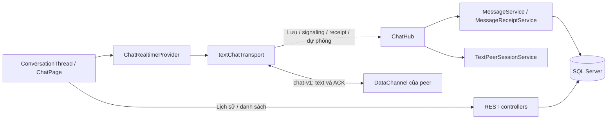
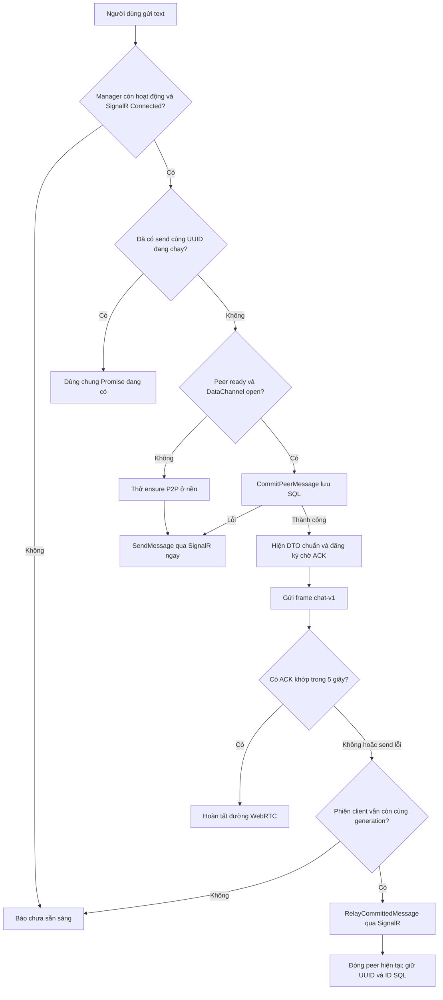
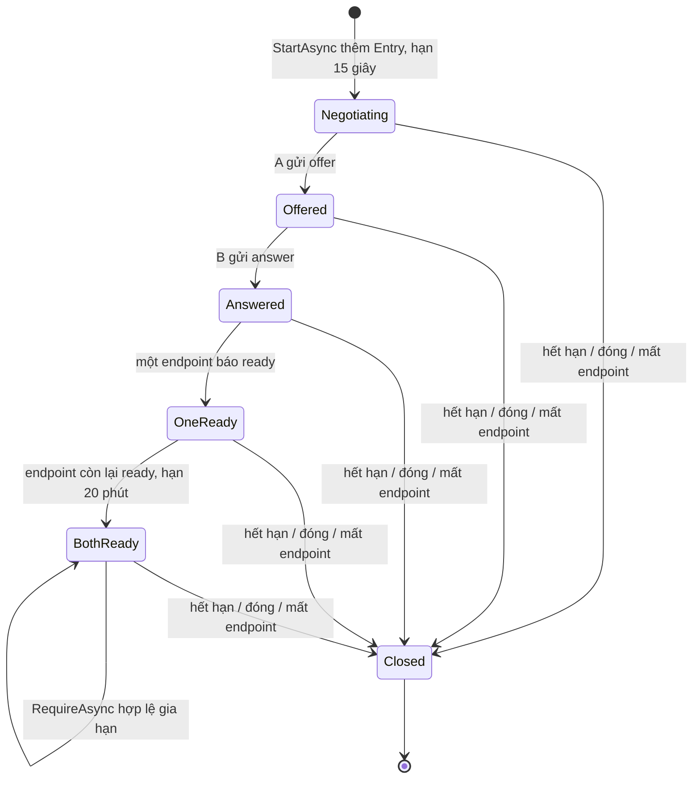
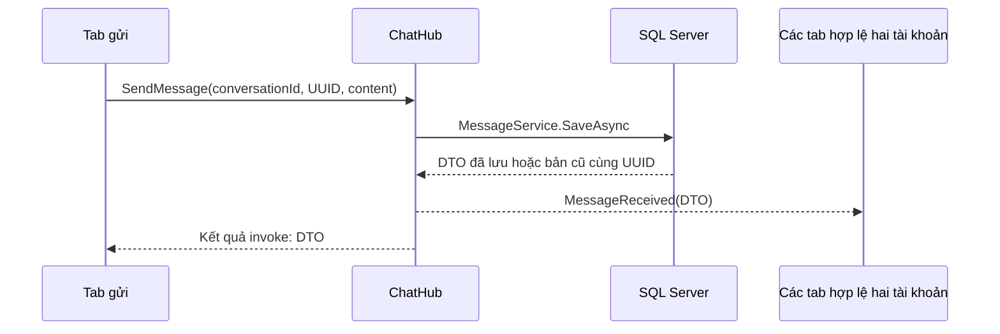
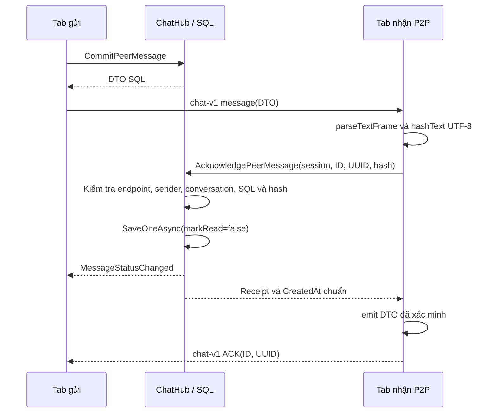

# Đặc tả chi tiết chức năng tin nhắn

Ngày đối chiếu mã nguồn: **30/10/2026**.

Tài liệu mô tả **hành vi của mã nguồn trong working tree hiện tại**, bao gồm
phần tích hợp thẻ file vào chat đang chưa commit. Đây không phải biên bản xác
nhận mọi chức năng đã được triển khai trên AWS. Lượt viết tài liệu này không
chạy lại kiểm thử tích hợp, không đổi cấu hình và không sửa mã ứng dụng.

Các đường dẫn trong tài liệu mở file thực thi chức năng. Tên hàm, phương thức
và effect được ghi kèm để có thể tìm trực tiếp trong IDE. Những trạng thái
được diễn giải để dễ hiểu sẽ được phân biệt với trường thực sự có trong code.

## 1. Phạm vi và cách đọc

### 1.1. Các chức năng hiện có

| Nhóm | Hành vi hiện có |
| --- | --- |
| Cuộc trò chuyện | Tìm người, tạo/mở lại chat 1–1, tìm kiếm danh sách, phân trang |
| Text | Soạn, gửi, nhận realtime, lưu SQL, tải lịch sử, gửi lại cùng UUID |
| Đường gửi | WebRTC DataChannel khi sẵn sàng; SignalR khi chưa sẵn sàng hoặc giao P2P lỗi |
| Receipt | Đã nhận/đã đọc từng tin; còn hỗ trợ receipt cộng dồn của client cũ |
| Đồng bộ | Đồng bộ các tab đang kết nối; tải bù tin chưa giao khi nối lại |
| Hiển thị | Preview, số chưa đọc, thứ tự hoạt động, typing, online/offline, nhãn đường truyền |
| Tệp trong chat | Mời nhận file, chấp nhận/từ chối/hủy, tiến độ, xác minh SHA-256, tải xuống |
| Phân quyền | JWT, phiên đăng nhập, thành viên conversation, endpoint P2P và trạng thái tài khoản |

Phạm vi thực thi hiện tại là Web ↔ Web. Chưa có chat nhóm, sửa/xóa/thu hồi
tin, reaction, trả lời trích dẫn, chuyển tiếp, tìm kiếm nội dung lịch sử,
outbox text bền vững hoặc chat desktop LAN offline trong luồng đang mô tả.

### 1.2. Các phần quan trọng khi tra cứu

- Mục 3–5: vị trí code, dữ liệu, tạo conversation và thao tác soạn tin.
- Mục 6–8: chọn đường gửi, ICE, toàn bộ `TextPeerSessionService`.
- Mục 9–12: bộ điều phối client, lưu SQL, giao thức text, ACK/read.
- Mục 13–17: tải bù, thứ tự/unread, typing, presence và file trong chat.
- Mục 18–24: API, bảo mật, giới hạn, lỗi, kiểm thử và ví dụ xuyên suốt.

### 1.3. Những điều phải hiểu đúng

1. **Giao realtime và lưu lịch sử là hai việc khác nhau.** Text gửi qua
   WebRTC vẫn được đưa lên backend và lưu SQL trước khi giao cho peer.
2. **P2P chưa sẵn sàng không chặn gửi text.** Tin hiện tại đi SignalR ngay;
   việc thử kết nối P2P phục vụ các tin sau.
3. **WebRTC qua TURN vẫn là đường WebRTC.** SignalR dự phòng là một đường
   giao khác, không phải tên khác của TURN.
4. **Đã lưu chưa đồng nghĩa đã nhận; đã nhận chưa đồng nghĩa đã đọc.**
5. **Hiện vẫn cần server để gửi text mới.** Có DataChannel không biến ứng
   dụng thành hệ thống chat offline khi backend ngừng hoạt động.
6. **SQL có nội dung text.** Kiểm tra SHA-256 không tạo mã hóa đầu cuối
   khiến backend không đọc được bản lưu.
7. **SQL chỉ giữ metadata file.** Lịch sử file không bảo đảm có thể tải lại
   byte file sau khi tab nhận đã mất Blob.

## 2. Kiến trúc và trách nhiệm



| Thành phần | Trách nhiệm | Không đảm nhiệm |
| --- | --- | --- |
| Giao diện chat | Soạn tin, hiển thị, retry, chọn conversation | Tự quyết định người gửi hợp lệ trên server |
| `ChatRealtimeProvider` | Giữ kết nối theo phiên đăng nhập, heartbeat, tải bù, phân phối sự kiện | Lưu lịch sử bền vững trong trình duyệt |
| `textChatTransport` | Chọn SignalR/WebRTC, peer, ACK timeout, fallback, dọn tài nguyên | Tự chọn IP/candidate pair theo thuật toán riêng |
| `ChatHub` | Điều phối lệnh, xác thực ngữ cảnh, phát sự kiện | Tự giữ toàn bộ lịch sử trong RAM |
| `TextPeerSessionService` | Ràng buộc hai endpoint, kiểm tra signaling và thời hạn | Vận chuyển frame DataChannel, đo chất lượng mạng |
| `MessageService` | Chuẩn hóa, kiểm tra quyền, chống trùng, lưu SQL | Tự phát `MessageReceived` |
| `MessageReceiptService` | Ghi timestamp đã nhận/đã đọc | Chứng minh người dùng đã nhìn từng ký tự trên màn hình |
| SQL Server | Lịch sử text, receipt, conversation, metadata file | Lưu byte file truyền P2P |

## 3. Bản đồ file và hàm

Các đường dẫn được tính từ thư mục gốc repository.

### 3.1. Frontend

| File | Hàm/thành phần cần tìm | Chức năng |
| --- | --- | --- |
| [App.jsx](../frontend/src/App.jsx) | `App`, `authenticated`, `logout`, `sessionExpired` | Đặt provider bao ngoài các trang; kết thúc tài nguyên khi đổi phiên |
| [ChatPage.jsx](../frontend/src/pages/ChatPage.jsx) | `select`, `submitMessage`, `loadOlderMessages`, các effect | Điều phối danh sách, thread, lịch sử, read, typing |
| [ConversationThread.jsx](../frontend/src/components/chat/ConversationThread.jsx) | `ConversationThread`, `submit`, `retryMessage`, `selectFile` | Ô soạn, bubble text, nhãn receipt, thẻ file |
| [ConversationList.jsx](../frontend/src/components/chat/ConversationList.jsx) | `ConversationList`, `formatActivityTime` | Sidebar, preview, thời gian, unread, tìm kiếm |
| [NewConversationDialog.jsx](../frontend/src/components/chat/NewConversationDialog.jsx) | `search`, `retrySearch`, `create`, effect tìm kiếm | Tìm và chọn người bắt đầu chat |
| [ChatRealtimeProvider.jsx](../frontend/src/realtime/ChatRealtimeProvider.jsx) | `ChatRealtimeProvider`, `synchronizePendingMessages`, `requestSynchronization` | Socket, manager text, phục hồi kết nối |
| [chatConnection.js](../frontend/src/services/chatConnection.js) | `createChatConnection`, các hàm `listenFor...`, `setTyping` | SignalR wrapper và lifecycle |
| [textChatTransport.js](../frontend/src/services/textChatTransport.js) | `createTextChatTransport`, `sendOne`, `ensure`, `sessionStarted`, `attach` | Quyết định đường gửi và vận hành P2P text |
| [textProtocol.js](../frontend/src/services/textProtocol.js) | `parseTextFrame`, `hashText`, `classifyTextRoute`, `textRouteLabel` | Kiểm tra frame, hash và diễn giải đường mạng |
| [chatState.js](../frontend/src/utils/chatState.js) | `mergeChatMessages`, `applyMessageStatus`, `upsertConversationMessage`, `sortConversations` | Chống trùng, receipt, preview, unread, thứ tự |
| [chatTimeline.js](../frontend/src/utils/chatTimeline.js) | `chatTimeline`, `formatFileSize`, `fileTypeLabel` | Ghép text/file để render |
| [conversationsApi.js](../frontend/src/services/conversationsApi.js) | `searchUsers`, `list`, `get`, `messages`, `pendingMessages`, `create` | Gọi REST chat |
| [apiClient.js](../frontend/src/services/apiClient.js) | `request` | JWT header, JSON, timeout HTTP, lỗi |
| [heartbeat.js](../frontend/src/services/heartbeat.js) | `createHeartbeatLoop`, `beat`, `stop` | Heartbeat ứng dụng, tránh gửi chồng |
| [FileMessageCard.jsx](../frontend/src/components/chat/FileMessageCard.jsx) | `FileMessageCard`, `act` | Thao tác file ngay trong chat |
| [FileTransferProvider.jsx](../frontend/src/realtime/FileTransferProvider.jsx) | `FileTransferProvider`, `loadConversation` | Dùng chung controller file giữa trang Chat và Tệp |
| [fileTransfers.js](../frontend/src/services/fileTransfers.js) | `createFileTransfers`, `offer`, `action`, `loadConversation` | Truyền file, metadata, lịch sử riêng theo chat |
| [fileProtocol.js](../frontend/src/services/fileProtocol.js) | `encodeChunk`, `createFileReceiver`, `waitForBuffer`, `sha256` | Chunk, backpressure, kiểm tra byte |
| [Statusbar.jsx](../frontend/src/components/layout/Statusbar.jsx) | `Statusbar` | Trạng thái SignalR toàn ứng dụng và số phiên file đang truyền |

### 3.2. Backend và dữ liệu

| File | Hàm/thành phần cần tìm | Chức năng |
| --- | --- | --- |
| [Program.cs](../PBL4/Program.cs) | `Main` | Đăng ký service, CORS, middleware, `/hubs/chat` |
| [ChatHub.cs](../PBL4/Realtime/ChatHub.cs) | Các method ở mục 18 | Gửi text, signaling, receipt, typing, file, heartbeat |
| [IChatClient.cs](../PBL4/Realtime/IChatClient.cs) | Các callback client | Contract sự kiện server phát |
| [MessageService.cs](../PBL4/Services/MessageService.cs) | `SaveAsync`, `Existing`, `ToDto` | Lưu text dùng chung mọi đường |
| [MessageReceiptService.cs](../PBL4/Services/MessageReceiptService.cs) | `SaveOneAsync`, `SaveAsync` | Receipt từng tin và cộng dồn |
| [TextPeerSessionService.cs](../PBL4/Services/TextPeerSessionService.cs) | `StartAsync`, `RequireAsync`, `ReadyAsync`, `SignalAsync`, `SweepAsync` | Registry phiên text trong RAM |
| [TextPeerMonitor.cs](../PBL4/Realtime/TextPeerMonitor.cs) | `ExecuteAsync` | Dọn phiên định kỳ |
| [ConversationsController.cs](../PBL4/Controllers/ConversationsController.cs) | `OwnConversations`, `Project`, `WithPresence`, `List`, `Get`, `Create` | Cuộc trò chuyện và preview |
| [MessagesController.cs](../PBL4/Controllers/MessagesController.cs) | `List` | Phân trang lịch sử text |
| [PendingMessagesController.cs](../PBL4/Controllers/PendingMessagesController.cs) | `List` | Các tin đến chưa có `DeliveredAt` |
| [UsersController.cs](../PBL4/Controllers/UsersController.cs) | `Search` | Tìm người khác để chat |
| [PresenceTracker.cs](../PBL4/Realtime/PresenceTracker.cs) | `Connect`, `RecordHeartbeat`, `IsOnline`, `GetValidConnectionIds`, `CheckTimeouts` | Theo dõi socket và online |
| [PresenceService.cs](../PBL4/Realtime/PresenceService.cs) | `RecordHeartbeatAsync`, `CheckTimeoutsAsync`, `RevokeSessionAsync`, `NotifyAsync` | Lưu `LastSeenAt`, phát presence |
| [TypingRateLimiter.cs](../PBL4/Realtime/TypingRateLimiter.cs) | `AllowStart`, `Stop` | Giới hạn nhịp typing |
| [RealtimeSessionFilter.cs](../PBL4/Realtime/RealtimeSessionFilter.cs) | `InvokeMethodAsync` | Kiểm tra phiên và user mỗi lần gọi Hub |
| [SessionValidationEvents.cs](../PBL4/Auth/SessionValidationEvents.cs) | `MessageReceived`, `TokenValidated` | Đọc token Hub, xác thực session/account |
| [FilesController.cs](../PBL4/Controllers/FilesController.cs) | `Configuration`, `ConversationFiles` | Cấu hình ICE dùng chung và lịch sử file |
| [FileTransferService.cs](../PBL4/Services/FileTransferService.cs) | `OfferAsync`, `ActAsync`, `SignalAsync`, `ListAsync`, `SweepAsync` | Nghiệp vụ file |
| [MessageDtos.cs](../PBL4/Contracts/MessageDtos.cs), [TextPeerDtos.cs](../PBL4/Contracts/TextPeerDtos.cs), [ConversationDtos.cs](../PBL4/Contracts/ConversationDtos.cs) | DTO request/response/event | Dữ liệu trao đổi, không trả entity trực tiếp |
| [Message.cs](../PBL4/Models/Message.cs), [AppDBContext.cs](../PBL4/Data/AppDBContext.cs), [01_schema.sql](../database/01_schema.sql) | Entity, EF mapping, SQL DDL | Cấu trúc và ràng buộc lưu trữ |

## 4. Thuật ngữ, danh tính và dữ liệu của một tin

### 4.1. Phân biệt các ID

| ID | Ai cấp | Tồn tại bao lâu | Ý nghĩa |
| --- | --- | --- | --- |
| `UserId` | SQL khi đăng ký | Theo tài khoản | Người tham gia chat |
| `sid` / session đăng nhập | Backend auth | Theo phiên JWT | Kiểm tra thu hồi quyền truy cập |
| `ConnectionId` | SignalR | Theo một kết nối; có thể đổi sau reconnect | Một tab/socket đang kết nối |
| `ConversationId` | SQL | Theo cặp người dùng | Chat 1–1 duy nhất của cặp |
| `ClientMessageId` | Client bằng UUID | Giữ nguyên qua retry/fallback | Chống trùng tin của cùng người gửi |
| `MessageDto.id` | SQL BIGINT | Theo bản ghi | ID chuẩn sau khi lưu |
| `local:<UUID>` | Giao diện | Tạm thời trước khi có ID SQL | Bubble optimistic |
| `TextPeerSessionDto.sessionId` | Server, GUID dạng `N` | Theo một phiên giữa hai endpoint | Quyền tham gia signaling/commit P2P |
| `TransferId` / `ClientTransferId` | SQL / client | Theo lần truyền file | Khác hoàn toàn ID tin text |

`UserAId`/`UserBId` trong DTO phiên P2P là vai trò khởi tạo/đích của phiên;
không được suy ra rằng chúng luôn bằng cặp min/max `UserAID`/`UserBID` trong
bảng `DirectConversations`. `StartAsync` đặt người gọi làm A của phiên.

### 4.2. Bảng `Messages`

| Trường | Kiểu trong SQL script | Quy tắc |
| --- | --- | --- |
| `Id` | `BIGINT IDENTITY` | Khóa chính, JSON trả chuỗi |
| `ClientMessageId` | `UNIQUEIDENTIFIER` | Client tạo; không được rỗng |
| `ConversationId` | `BIGINT` | Khóa ngoại tới conversation |
| `SenderId` | `INT` | Lấy từ JWT trên server |
| `Content` | `NVARCHAR(4000)` | Text sau trim, không rỗng |
| `CreatedAt` | `DATETIME2(3)` | Thời gian UTC server khi tạo tin |
| `DeliveredAt` | `DATETIME2(3) NULL` | Điền khi nhận ACK/read hợp lệ |
| `ReadAt` | `DATETIME2(3) NULL` | Điền khi nhận lệnh read hợp lệ |
| `RowVersion` | `ROWVERSION` | Token phiên bản DB; không phải ngày giờ; không nằm trong `MessageDto` |

JavaScript giữ BIGINT bằng chuỗi để không mất chính xác trên
`Number.MAX_SAFE_INTEGER`. `persistedId()` trong `chatState.js` dùng `BigInt`
khi so sánh ID. Thời gian trong DTO được gắn UTC; UI đổi sang giờ địa phương.

### 4.3. Ràng buộc DB và khác biệt giữa các định nghĩa

- Unique `(SenderId, ClientMessageId)` là hàng rào chống insert trùng ngay cả
  khi nhiều request cùng vượt qua bước tra cứu của service.
- Timestamp phải đúng quan hệ: `DeliveredAt >= CreatedAt`; nếu có `ReadAt`
  thì phải có `DeliveredAt` và `ReadAt >= DeliveredAt`.
- SQL script có `TR_Messages_Member` kiểm tra sender là thành viên; trigger
  `TR_DirectConversations_ImmutablePair` chặn đổi cặp người sau khi tạo.
- SQL script có index lịch sử, pending và unread; pending/unread dùng
  filtered index. Không suy ra DB đang chạy có đủ chúng chỉ từ tên entity.
- EF mapping và SQL script có khác biệt: EF cấu hình cascade từ conversation
  tới messages, SQL script không ghi `ON DELETE CASCADE`; các trigger/index
  chuyên biệt cũng không được mô tả đầy đủ trong EF mapping hiện tại.

Tài liệu này mô tả cả hai nguồn, không khẳng định một schema DB cụ thể đang
trùng hoàn toàn. Muốn xác nhận production phải đọc metadata DB riêng; không
chạy lại schema hoặc migration chỉ vì đọc mục này.

## 5. Tìm người, tạo cuộc trò chuyện và soạn tin

### 5.1. Tìm người và tạo/mở lại chat

**Vị trí:** `NewConversationDialog.jsx` → `conversationsApi.searchUsers/create`
→ `UsersController.Search` / `ConversationsController.Create`.

1. Mở **Cuộc trò chuyện mới**. Dialog native gọi `showModal()`, focus ô tìm.
2. Nhập ít nhất 2 ký tự sau trim. Client debounce 300 ms, hủy request cũ;
   server giới hạn từ khóa tối đa 100 ký tự.
3. `Search` tìm trong username/display name, loại chính mình và user bị khóa,
   trả tối đa 20 người theo username rồi ID. Không trả toàn bộ danh bạ khi
   từ khóa ngắn.
4. Chọn một người rồi gọi `create()`. Client chỉ gửi `{ peerUserId }`.
5. Server lấy người hiện tại từ JWT; từ chối chat với chính mình hoặc peer
   không tồn tại/bị khóa. Không bắt buộc hai người đã lưu danh bạ.
6. Chuẩn hóa `UserAID = min(id1,id2)`, `UserBID = max(id1,id2)`; nếu đã có
   conversation thì trả bản cũ (`200`). Nếu tạo mới thì trả `201` và Location.
7. Unique pair giải quyết tạo đồng thời; request thua lỗi SQL 2601/2627 đọc
   lại bản ghi thắng. Lỗi FK 547 trong lúc insert được trả `409`.
8. Conversation mới phát `ConversationChanged` tới kết nối hợp lệ hai người.
   Khi mở lại bản có sẵn, code trả kết quả mà không phát sự kiện tạo mới.
9. `ChatPage.created()` đóng dialog, bỏ bộ lọc, làm mới danh sách rồi `select()`.

`Project()` tính `isContact` theo danh bạ **của người đang xem**. A lưu B
không làm B tự lưu A. `contactAdded()` chỉ cập nhật UI sau khi lưu thành công;
liên hệ này không tạo thêm hoặc thay đổi danh tính conversation.

### 5.2. Mở thread và tải dữ liệu

**Vị trí:** `ChatPage.select()` và các effect tải detail/history/files.

- Dừng typing của chat cũ, đặt ID mới và đổi giao diện hẹp sang thread.
- Xóa dữ liệu thread cũ, trạng thái typing cũ, lỗi/cursor và pending read.
- Tải riêng chi tiết conversation, lịch sử text và lịch sử file. History file
  được yêu cầu khi SignalR của provider ở trạng thái `connected`.
- Request detail/text cũ bị hủy khi đổi chat để kết quả chậm không chèn nhầm.
- `detailLoading` tạo thông báo **Đang mở cuộc trò chuyện…**; nó phụ thuộc
  request chi tiết, không có nghĩa client đang chờ P2P.
- `retryDetail()`, `retryHistory()` tăng revision để tải lại phần bị lỗi.

### 5.3. Quy tắc ô soạn

**Vị trí:** `ConversationThread.submit()`, textarea và `retryMessage()`.

| Thao tác/điều kiện | Hành vi |
| --- | --- |
| Nội dung chỉ có khoảng trắng | Không submit |
| Nội dung hợp lệ | `draft.trim()` trước khi gọi `onSend` |
| Giới hạn | Textarea `maxLength=4000`; server kiểm tra lại sau trim |
| Enter không giữ Shift | Chặn xuống dòng mặc định, gọi form `requestSubmit()` |
| Shift+Enter | Để textarea xuống dòng |
| Đang submit | Cờ `sending` chặn submit form lặp |
| Gửi thành công | Xóa draft và báo ngừng typing |
| Gửi thất bại | Giữ draft, hiện lỗi; bubble lỗi có nút **Gửi lại** |
| Đổi conversation | Component được remount theo key, draft không mang sang người khác |
| Peer bị khóa hoặc SignalR chưa connected | Vô hiệu ô nhập và nút gửi |
| Chọn file | Giữ draft text, có cờ `sendingFile` và lỗi riêng |

Giới hạn `.length` trong JavaScript/.NET được tính theo đơn vị UTF-16;
không bảo đảm tương đương 4.000 ký tự hiển thị hoặc 4.000 emoji. Dữ liệu hiển
thị bằng nội suy text React, không đưa nội dung tin vào HTML thô.

`sending` không vô hiệu textarea: người dùng vẫn có thể sửa/gõ thêm draft
trong lúc chờ Promise gửi. Khi thành công, `setDraft('')` xóa draft hiện tại
mà không đối chiếu với snapshot lúc gửi. Hiện chưa bảo đảm giữ riêng phần
vừa gõ thêm trong khoảng chờ này.

### 5.4. Tạo bubble optimistic và retry

**Vị trí:** `ChatPage.submitMessage()`, `createClientMessageId()` và
`mergeChatMessages()` trong `chatState.js`.

1. Kiểm tra chat và kết nối hiện tại.
2. Tạo UUID bằng `crypto.randomUUID()`. Nếu thiếu API này thì dùng 16 byte
   từ `getRandomValues()`, đặt version/variant UUID v4; không có nguồn ngẫu
   nhiên an toàn thì báo lỗi.
3. Tạo bubble `id=local:<UUID>`, `sendState=sending`, thời gian máy client.
4. Gọi `sendTextMessage()` của provider, chuyển tiếp tới manager text.
5. Nhận DTO SQL thì ghép vào cùng bubble, thay ID/thời gian chuẩn và chuyển
   `sent`; không append một bubble mới chỉ vì có thêm event server.
6. Khi thất bại, nếu vẫn là thread đó và chưa có `deliveredAt`, đánh dấu
   `failed`. `retryMessage()` gọi lại với **UUID cũ**.

Nút gửi lại tái sử dụng UUID; tự bấm gửi nội dung còn trong draft là một
submit mới và có thể sinh UUID mới. Chống trùng theo UUID không phải chống
mọi lần gửi có nội dung giống nhau.

## 6. Quá trình tìm và ưu tiên cách gửi tin

### 6.1. Hai quyết định riêng biệt

| Quyết định | Nơi quyết định | Dữ liệu dùng để quyết định |
| --- | --- | --- |
| Giao text bằng WebRTC hay SignalR | `textChatTransport.send()` / `sendOne()` | SignalR state, peer, `peer.ready`, `channel.readyState`, kết quả commit/ACK |
| WebRTC đi trực tiếp hay TURN | ICE agent trong trình duyệt | Candidate và kiểm tra kết nối của WebRTC |
| Hiện nhãn đường nào | `route()` → `classifyTextRoute()` | Candidate pair thực sự được chọn trong stats |

Code không đo ping SignalR và TURN rồi tự chọn đường ít ms nhất. Ưu tiên
WebRTC là điều kiện theo trạng thái sẵn sàng; chất lượng mạng không được
chấm điểm bởi một thuật toán ứng dụng riêng.

### 6.2. Luồng quyết định đúng theo `sendOne()`



### 6.3. Từng bước tìm phiên và chọn đường

1. `ChatRealtimeProvider.sendTextMessage(message)` lấy manager hiện tại từ
   ref; chưa có manager thì trả Promise lỗi.
2. `manager.send()` từ chối nếu đã `disposed` hoặc SignalR không
   `Connected`. Có WebRTC đang mở cũng không bỏ qua điều kiện này.
3. Tra `sending.get(clientMessageId)` để gộp các lần gọi đồng thời cùng UUID.
   Promise này chỉ được giữ trong lúc thao tác còn đang chạy.
4. `sendOne()` ghi lại `generation` hiện tại, rồi tra:

   ```text
   conversationId -> byConversation -> sessionId -> peers -> peer
   ```

5. Nếu thiếu peer, `peer.ready=false` hoặc channel không `open`, gọi
   `void ensure(conversationId)` và **không await** việc thương lượng. Gửi
   `SendMessage` ngay. Khi thành công, `emit(result)` nếu còn cùng generation.
6. Nếu có peer sẵn sàng, gọi `CommitPeerMessage`. Server kiểm tra lại cả hai
   đầu ready; trạng thái local không phải quyền vượt qua kiểm tra server.
7. Nếu commit ném lỗi, code thử `SendMessage` với cùng request/UUID. Nhánh
   catch áp dụng cho mọi lỗi commit, không chỉ timeout. Nếu nguyên nhân là
   nội dung/quyền không hợp lệ thì đường SignalR cũng có thể bị từ chối.
8. Commit thành công: kiểm tra generation, `emit(saved)`, đăng ký waiter
   **trước** `channel.send()`, rồi gửi frame chứa DTO đã lưu.
9. ACK đúng thì hoàn tất; lỗi gửi/ACK timeout thì relay bản SQL. Nếu đã
   logout/reconnect sang generation khác, thao tác cũ không tự relay tiếp.

### 6.4. Bảng tình huống chọn đường

| Tình huống lúc gửi | Đường của tin hiện tại | Tác động tới P2P |
| --- | --- | --- |
| Vừa mở chat, chưa có peer | SignalR | Thử tạo phiên ở nền |
| Peer đang thương lượng | SignalR | Không đợi hết 15 giây mới giao text |
| Browser thiếu WebRTC/Web Crypto | SignalR | `ensure()` bỏ qua |
| Người nhận không có socket hợp lệ | SignalR lưu SQL; chờ người nhận tải bù | Server trả `null` khi start phiên |
| Channel mở, local ready, server chấp nhận commit | WebRTC | Giữ phiên cho các tin tiếp |
| Local ready nhưng server chưa thấy đủ hai ready | Thử SignalR cùng UUID | Có thể gửi được dù P2P chưa đồng bộ trạng thái |
| Không biết commit đã thành công hay chưa | Thử SignalR cùng UUID | Unique SQL trả bản cũ nếu đã lưu |
| Channel send lỗi hoặc ACK mất/quá 5 giây | Relay qua SignalR | Release phiên hiện tại |
| TURN là candidate được chọn | WebRTC qua TURN | Vẫn dùng commit/ACK P2P như đường trực tiếp |
| SignalR đã ngắt | Báo lỗi/chờ nối lại | Không gửi mới chỉ bằng DataChannel |

### 6.5. Khi nào ứng dụng tìm P2P lại?

- Effect của `ChatPage`: khi chọn chat, SignalR connected hoặc thông tin
  `conversation.peer.isOnline` thay đổi.
- Nhánh SignalR của `sendOne()`: thử `ensure()` cho conversation đang gửi.
- `ChatRealtimeProvider`: gọi `manager.refresh()` mỗi 15 giây cho các chat
  trong tập `desired`.
- Sau `onReconnected`: tải bù và yêu cầu refresh các phiên mong muốn.

`refresh()` bỏ qua phiên/Promise đang có thông qua `ensure()`. Đây không
phải retry vô hạn một thao tác gửi cùng UUID, cũng không phải ICE restart
trên peer cũ. Ứng dụng có thể đóng peer cũ và thương lượng một phiên mới.

## 7. WebRTC tìm đường mạng và hiển thị ưu tiên

### 7.1. Cấu hình ICE lấy ở đâu?

`createTextChatTransport.config()` gọi `loadConfiguration()`, mặc định dùng
`request('/files/configuration')`. `FilesController.Configuration()` trả
`maximumFileBytes` và `iceServers` từ `WebRtc:IceServers`. Text và file dùng
chung nguồn cấu hình này; tên route `/files` không làm text đi qua kênh file.

Promise cấu hình được cache trong vòng đời manager. Nếu tải lỗi thì xóa
cache để lần sau thử lại. `sessionStarted()` tạo:

```javascript
new RTCPeerConnection({ iceServers: settings.iceServers || [] })
```

Đoạn trên không ép `iceTransportPolicy: 'relay'` và không tự sắp thứ tự thử
các đường mạng. Chỉ đọc file mặc định trong repo không đủ kết luận TURN trên
AWS đang bật/tắt; environment triển khai có thể ghi đè cấu hình.

### 7.2. Nguyên lý ICE và ranh giới trách nhiệm

ICE thu thập địa chỉ ứng viên, trao đổi với peer, lập cặp và kiểm tra kết
nối theo độ ưu tiên; phía điều khiển đề cử cặp để dùng. Host là địa chỉ
endpoint, server-reflexive được phát hiện qua STUN, relay được cấp qua TURN.
Quá trình không tương đương ba bước ứng dụng tuần tự “LAN xong rồi STUN,
STUN xong rồi TURN”. Xem [RFC 8445, mục 2 và 5–8](https://www.rfc-editor.org/rfc/rfc8445.html).

Trong ứng dụng, `onicecandidate` gửi candidate qua `SendTextSignal`; các
API `setRemoteDescription()` và `addIceCandidate()` đưa dữ liệu cho browser.
Thuật toán mạng nằm trong triển khai WebRTC, không nằm trong
`TextPeerSessionService`. API và tùy chọn được định nghĩa trong
[đặc tả WebRTC của W3C](https://www.w3.org/TR/webrtc/).

### 7.3. Đường thực sự được dùng khác danh sách candidate

**Vị trí:** `textProtocol.classifyTextRoute(stats)` và `route(peer)`.

1. Tìm stats kiểu `transport` có `selectedCandidatePairId`.
2. Lấy pair theo ID đó. Khi không có transport phù hợp, thử pair có
   `selected=true`, `state=succeeded` theo nhánh tương thích hiện có.
3. Lấy local/remote candidate của pair.
4. Nếu một trong hai có `candidateType=relay`, trả `turn`.
5. Nếu có đủ hai candidate type và không relay, trả `direct`.
6. Thiếu pair/type thì trả `webrtc`, không khẳng định trực tiếp.

Chỉ thấy một relay candidate được thu thập chưa chứng minh phiên đã dùng
TURN. UI phân loại cặp được chọn; không kiểm tra “trong tất cả candidate có
chữ relay hay không”. `route()` được gọi lúc channel sẵn sàng, kết nối hồi
phục và gửi tin; đây không phải bộ lấy stats liên tục mỗi frame.

| State/route client | Nhãn từ `textRouteLabel()` |
| --- | --- |
| `state=connecting` | Đang kết nối P2P · tạm dùng SignalR |
| `route=direct` | WebRTC trực tiếp |
| `route=turn` | WebRTC qua TURN |
| `route=webrtc` | WebRTC · chưa xác định đường mạng |
| Mặc định/fallback | SignalR dự phòng |

`ConversationThread` thay nhãn bằng **Đường truyền text đã ngắt** khi
SignalR không connected. Nhãn route mô tả trạng thái đường hiện tại, không
phải bằng chứng lưu sẵn đường đi của từng tin trong bảng `Messages`.

## 8. Chi tiết `TextPeerSessionService` trên server

### 8.1. Vị trí, lifetime và dữ liệu

**File:** [TextPeerSessionService.cs](../PBL4/Services/TextPeerSessionService.cs).
`Program.Main()` đăng ký service dạng singleton. `ChatHub` gọi service,
`TextPeerMonitor` dọn định kỳ. Mỗi thao tác DB của registry tự tạo scope;
không giữ một scoped `AppDbContext` làm field của singleton.

| Thành phần | Kiểu | Tác dụng |
| --- | --- | --- |
| `gate` | `SemaphoreSlim(1,1)` | Tuần tự hóa thao tác registry bất đồng bộ |
| `active` | `Dictionary<string, Entry>` | Tra phiên theo SessionId trong RAM |
| `Entry.Session` | `TextPeerSessionDto` | Conversation, hai user và hai connection |
| `Entry.Deadline` | `DateTimeOffset` | Hạn hợp lệ của phiên |
| `Entry.Offered` | `bool` | Server đã tiếp nhận offer |
| `Entry.Answered` | `bool` | Server đã tiếp nhận answer |
| `Entry.Ready` | `HashSet<string>` | Các ConnectionId đã báo ready |
| `Entry.Candidates` | `Dictionary<string,int>` | Số ICE đã tiếp nhận từng endpoint |

Không có bảng SQL `TextPeerSessions`, không lưu SDP/ICE vào `Messages` và
không có trường `Status` dạng enum trong `Entry`. Các tên “đang thương
lượng”, “ready”, “đã đóng” dưới đây diễn giải tổ hợp cờ/registry, không phải
tên cột DB. Restart backend làm mất registry phiên này.

### 8.2. `StartAsync`: tìm phiên, chọn endpoint, cấp phiên mới

Đầu vào là `userId`, `connectionId`, `conversationId`, cancellation token.
`ChatHub.StartTextSession()` lấy user/connection từ ngữ cảnh đã xác thực.

Thứ tự xử lý thực tế:

1. Parse conversation ID dương và chuẩn hóa thành chuỗi số; sai thì
   `TEXT_INVALID_CONVERSATION`.
2. Lấy `gate`, chạy `SweepLockedAsync()` dọn phiên cũ trước khi tra/tạo.
3. Đọc conversation có người gọi là thành viên, suy ra peer. Không tìm thấy
   hoặc peer bị khóa thì `TEXT_PEER_UNAVAILABLE`.
4. Đảm bảo ConnectionId người gọi nằm trong `GetValidConnectionIds()` của
   chính user; sai thì `TEXT_SESSION_CLOSED`.
5. Tra phiên cùng conversation có **connection người gọi** ở A hoặc B.
   Có thì trả lại DTO phiên đó, không tạo GUID mới.
6. Lấy connection hợp lệ của peer, sắp bằng `StringComparer.Ordinal`, chọn
   phần tử đầu. Không có thì trả `null`; client tiếp tục SignalR.
7. Nếu target đã thuộc phiên của conversation này thì trả `null`. Code
   không tiếp tục thử lần lượt các tab còn lại sau target đầu tiên bị bận.
8. Kiểm tra toàn registry dưới 1.000 phiên và mỗi user dưới 8 phiên; quá
   thì `TEXT_SESSION_LIMIT`. `Count()` đếm user ở cả vai A và B.
9. Cấp `Guid.NewGuid().ToString("N")`; caller làm A, target làm B, deadline
   ban đầu bằng thời gian hiện tại cộng 15 giây.
10. Thêm entry vào `active`, phát `TextSessionStarted` tới hai connection,
    trả DTO; `finally` giải phóng gate.

**Hệ quả khi nhiều tab:** phiên gắn với endpoint, không chỉ tài khoản.
Đây không phải bộ chọn tab đang focus, tab có mạng nhanh nhất hoặc tab có
heartbeat mới nhất. Không dùng `IsOnline()` làm điều kiện chọn target;
`GetValidConnectionIds()` kiểm tra socket connected và session hợp lệ.

Không có ràng buộc một phiên toàn cục duy nhất cho mọi tab của conversation;
code kiểm tra phiên chứa caller và target đã chọn. Trường hợp hai endpoint
của cùng cặp cùng khởi tạo được tuần tự hóa để dùng lại phiên chứa chúng;
không suy rộng thành bảo đảm mọi tổ hợp nhiều tab đều nhận một SessionId.

### 8.3. `RequireLocked`: quyền tham gia phiên

Hàm nội bộ chỉ được gọi khi đang giữ `gate`:

- SessionId phải có, tồn tại trong `active` và chưa đến deadline.
- UserId **và** ConnectionId phải cùng khớp endpoint A hoặc B.
- Cả hai connection phải còn trong tập connection hợp lệ của hai user.

Sai phiên/hết hạn/mất kết nối: `TEXT_SESSION_CLOSED`. Có SessionId nhưng
sai tài khoản hoặc tab: `TEXT_WRONG_ENDPOINT`. Chỉ biết GUID không cấp quyền
gửi signaling hoặc commit. Hàm này không trực tiếp query `IsDisabled` của
hai user; filter và worker/những nghiệp vụ liên quan bổ sung kiểm tra đó.

### 8.4. `SignalAsync`: chuyển SDP/ICE

| Kind | Quyền/thứ tự | Kiểm tra payload |
| --- | --- | --- |
| `offer` | Chỉ A, chưa có offer | Không rỗng, tối đa 24.000 ký tự |
| `answer` | Chỉ B, đã có offer, chưa có answer | Không rỗng, tối đa 24.000 ký tự |
| `ice` | Endpoint hợp lệ trong phiên | Tối đa 4.096 ký tự; JSON object có `candidate` kiểu string; dưới 128 candidate đã nhận của endpoint |
| Khác | Từ chối | `TEXT_INVALID_SIGNAL` |

Offer/answer được kiểm tra vai trò, số lần và độ dài; server không có SDP
parser để xác nhận nội dung là mô tả mạng hoạt động. ICE được kiểm tra dạng
JSON, không tự kiểm tra candidate có thể kết nối thực tế hay không.

Sau kiểm tra, cập nhật cờ/bộ đếm và phát `TextSignal` **chỉ tới endpoint còn
lại**, không broadcast cho mọi tab. Code chưa yêu cầu `Offered/Answered`
trước mọi ICE; hàng đợi client chịu trách nhiệm giữ thứ tự phù hợp. Một phiên
chỉ nhận một offer và một answer; không có renegotiation/ICE restart riêng.

`SignalAsync()` gọi `RequireLocked()` trực tiếp, không tự gia hạn deadline
thông qua `RequireAsync()`. Nhận nhiều signaling không tự kéo dài cửa sổ
thương lượng ban đầu.

### 8.5. `ReadyAsync`: hai endpoint sẵn sàng

`attach().channel.onopen` ở client gọi `ChatHub.TextSessionReady()`.
Server lấy gate, xác thực endpoint và yêu cầu `Answered=true`; sai trạng thái
thì `TEXT_INVALID_SIGNAL_STATE`. Sau đó thêm ConnectionId vào `Ready`.

- `HashSet` chặn một endpoint báo lặp để biến thành hai endpoint.
- Chỉ khi `Ready.Count == 2` mới đặt deadline thành hiện tại + 20 phút.
- Trong `channel.onopen`, client đặt `peer.ready=true` sau lời gọi ready
  của mình thành công. Callback PC chuyển `connected` khi channel đã open
  cũng có thể đặt local ready mà không chờ/gọi lại `TextSessionReady`.
  Vì vậy local ready không chứng minh server đã nhận ready của chính đầu
  đó trong mọi thứ tự callback, càng không chứng minh đủ hai endpoint.
- Không có sự kiện riêng “cả hai ready” được phát cho client. Quyền commit
  vẫn được server kiểm tra lại ở thời điểm gọi `CommitPeerMessage`.

### 8.6. `RequireAsync`: dùng phiên cho nghiệp vụ

`RequireAsync(userId, connectionId, sessionId, ready=false)`:

1. Lấy gate và gọi `RequireLocked()`.
2. Nếu `ready=true`, yêu cầu `Ready.Count==2`, nếu không thì
   `TEXT_PEER_NOT_READY`.
3. Đặt deadline hiện tại + 20 phút, trả DTO phiên rồi nhả gate.

`CommitPeerMessage` gọi với `ready=true`; `AcknowledgePeerMessage` dùng giá
trị mặc định. Vì việc gia hạn nằm ngay trong hàm này, không nên diễn giải
20 phút thành “bất kỳ signaling/heartbeat nào cũng gia hạn”. Việc kiểm tra
payload message hoặc hash ở Hub diễn ra sau khi `RequireAsync()` trả về.

### 8.7. `CloseAsync`, `SweepAsync`, `RemoveLockedAsync`

| Hàm | Ai gọi | Hành vi |
| --- | --- | --- |
| `CloseAsync` | `ChatHub.CloseTextSession` | Phiên không có thì bỏ qua; phiên còn có phải đúng endpoint, sau đó remove |
| `SweepAsync(disconnected)` | Worker hoặc `ChatHub.OnDisconnectedAsync` | Lấy gate trước khi gọi hàm dọn nội bộ |
| `SweepLockedAsync` | Start hoặc Sweep | Query tập user chưa bị khóa, lấy connection hợp lệ; loại entry hết hạn, mất endpoint, endpoint vừa disconnect hoặc user không còn khả dụng |
| `RemoveLockedAsync` | Close/Sweep nội bộ | Xóa khỏi `active` trước, rồi phát `TextSessionClosed` tới hai connection |
| `Error` | Các nhánh kiểm tra | Tạo `HubException` với tiền tố `TEXT_` |

`TextPeerMonitor.ExecuteAsync()` chạy mỗi 5 giây, log lỗi một lượt dọn rồi
tiếp tục các lượt sau. Thời điểm thông báo dọn có thể trễ do nhịp quét/tải;
nhưng lời gọi nghiệp vụ vẫn kiểm tra deadline ngay. Xóa registry không xóa
lịch sử SQL. Client nhận sự kiện đóng sẽ dọn peer và yêu cầu tải bù nền.

### 8.8. Vòng đời diễn giải từ các cờ



Sơ đồ thể hiện luồng bình thường; `RequireAsync()` mặc định có thể gia hạn
phiên hợp lệ mà không yêu cầu hai ready. Cơ chế là cờ và deadline, không
phải state machine enum cưỡng chế mọi chuyển trạng thái trong sơ đồ.

## 9. Bộ điều phối text trên client

### 9.1. Các cấu trúc trong `createTextChatTransport()`

**File:** [textChatTransport.js](../frontend/src/services/textChatTransport.js).
Manager được tạo cho phiên đăng nhập trong `ChatRealtimeProvider`, không
được tạo mới chỉ vì đổi từ trang Chat sang trang Tệp.

| Biến | Nội dung | Mục đích |
| --- | --- | --- |
| `peers` | SessionId → peer | Tìm RTCPeerConnection/channel/timer của phiên |
| `byConversation` | ConversationId → SessionId | Tìm đường text của chat khi gửi |
| `desired` | Set conversation mong muốn | Giữ tối đa 8 chat để thử P2P lại |
| `starting` | ConversationId → Promise start | Chống gọi StartTextSession trùng lúc |
| `acknowledgements` | ClientMessageId → waiter | Chờ ACK khớp session và MessageId |
| `received` | sender + UUID → DTO đã ghép | Giữ tối đa 512 danh tính tin gần đây trong manager |
| `sending` | ClientMessageId → Promise gửi | Gộp các retry đồng thời trong lúc đang gửi |
| `configuration` | Promise cấu hình ICE | Dùng chung yêu cầu cấu hình; xóa khi tải lỗi |
| `controller` | AbortController | Hủy việc tải cấu hình khi dispose |
| `generation` | Số thế hệ manager/kết nối | Bỏ kết quả cũ sau disconnect/logout |
| `disposed` | Boolean | Không phát cập nhật sau khi hủy manager |

`desired` loại phần tử thêm đầu tiên khi vượt 8; `Set.add()` một phần tử
đang có không đưa nó xuống cuối. Đây không phải LRU theo lần vừa mở chat.
Cache này cũng không phải lịch sử SQL, và giới hạn 8 phía client khác việc
server đếm tổng phiên của một tài khoản qua nhiều tab.

### 9.2. `ensure()` và `sessionStarted()`

`ensure(conversationId)` chỉ chạy khi manager còn sống, SignalR connected,
có Web Crypto và có WebRTC native nếu dùng factory mặc định. Nó cập nhật
`desired`, dùng lại phiên hoặc Promise đang có, rồi gọi `StartTextSession`.
Kết quả thuộc generation cũ bị bỏ qua. Server trả `null` thì không có peer
mới; lỗi được chuyển thành trạng thái dự phòng để text vẫn có thể đi server.

`sessionStarted(session)` có thể được gọi từ cả sự kiện và kết quả invoke:

1. Bỏ phiên đã có, manager đã hủy hoặc kết nối không còn Connected.
2. Đối chiếu **cả UserId và ConnectionId** để xác định mình là A hay B.
3. Nếu chat đã ánh xạ sang phiên khác, release phiên cũ.
4. Đăng ký peer trước khi chờ cấu hình để signal đến sớm tìm được nơi chờ.
5. Tạo RTCPeerConnection, callback ICE, connection state, datachannel.
6. Bắt timer thương lượng client 15 giây sau khi khởi tạo PC/callback.
   Deadline 15 giây phía server đã bắt đầu từ lúc cấp entry, nên hai timer
   không nhất thiết bắt đầu cùng thời điểm.
7. A tạo `chat-v1`, tạo offer và đặt local description; B chờ datachannel
   từ peer và trả answer khi nhận offer.

### 9.3. Ba hàng đợi Promise của một peer

| Hàng đợi | Nơi nối thêm tác vụ | Vấn đề được xử lý |
| --- | --- | --- |
| `outgoing` | Offer/answer và `onicecandidate` | ICE không vượt trước tác vụ gửi SDP ở client text |
| `signals` | `signalReceived()` | Các lời gọi setRemoteDescription/addIceCandidate không chạy đan xen tùy ý |
| `incoming` | `channel.onmessage` nhận message | Hash và ACK server bất đồng bộ không làm xử lý tin đảo thứ tự |

`peer.initialized` là Promise hàng rào. `signalReceived()` chờ nó trước
khi thao tác PC. ICE đến khi chưa có `remoteDescription` được xếp trong
`peer.candidates` tối đa 128 phần tử, rồi nạp sau khi có SDP. Signal của
SessionId không còn trong `peers` bị bỏ qua.

### 9.4. `attach()` và điều kiện DataChannel

Channel phải là duy nhất của peer, có label `chat-v1`, `ordered=true`,
`maxRetransmits=null`, `maxPacketLifeTime=null`. Không đúng thì đóng channel
và release peer. Hai trường null thể hiện code không chọn chế độ partial
reliability bằng số lần gửi lại hoặc thời gian tồn tại gói.

- `onopen`: gọi `TextSessionReady`, nếu phiên vẫn hiện tại thì clear timer,
  đặt local ready và đọc route.
- `onmessage`: parse frame; ACK khớp thì kết thúc waiter; frame message được
  xếp vào hàng đợi xác minh trước khi emit và trả ACK.
- `onclose`/`onerror`: release, đánh thức waiter để đường gửi có thể fallback.
- PC `failed`: release ngay.
- PC `disconnected`: bỏ local ready, tạm hiện connecting/SignalR; đặt timer
  5 giây. PC hồi `connected` và channel còn open thì clear timer, ready lại
  và đọc route; không hồi thì release.

### 9.5. Các hàm nhận, phát và dọn tài nguyên

| Hàm | Hành vi |
| --- | --- |
| `emit(message)` | Ghép với cache theo sender/UUID, giữ receipt, giới hạn cache 512, gọi callback UI |
| `receiveServer(message, acknowledge=true)` | Emit tin server; nếu là incoming thì gọi exact `AcknowledgeMessage` khi connected |
| `waitForAck(peer,message)` | Tạo timer 5 giây, lưu waiter trước lúc send; `finish()` xóa timer/waiter rồi resolve true/false |
| `closed(session)` | Release không gửi lại close tới server, yêu cầu tải bù nếu SignalR còn Connected |
| `refresh()` | Gọi ensure cho các chat trong desired |
| `release(sessionId,notify=true)` | Xóa ánh xạ/peer, bỏ handler, đóng channel/PC, clear timer, resolve waiter false, hiện fallback; có thể gọi CloseTextSession |
| `disconnected()` | Tăng generation, bỏ starting/sending, release peer không notify; giữ desired để thử lại |
| `dispose()` | Đặt disposed, tăng generation, abort cấu hình, off sự kiện, release các peer, xóa cache/tập mong muốn |

`release()` tháo handler trước khi close để không tạo chuỗi `onclose` gọi
lồng release. `onSyncNeeded()` khi server báo đóng phiên là cần thiết cho
trường hợp đã commit SQL nhưng tab gửi đóng trước khi gửi được payload.

## 10. Lưu và giao text qua server

### 10.1. `MessageService.SaveAsync()`

**Đầu vào:** sender đáng tin từ server và `SendMessageDto` gồm
`conversationId`, `clientMessageId`, `content`. **Đầu ra:** `SavedMessage`
gồm `MessageDto` và `PeerUserId`, chưa tự phát event.

Các bước:

1. Parse ConversationId dương; từ chối UUID rỗng.
2. Trim content; kiểm tra độ dài 1–4.000.
3. Đọc conversation mà sender là thành viên; suy ra peer, kiểm tra peer
   chưa bị khóa. Không nhận SenderId tùy ý từ request.
4. Tra bản ghi bằng sender + ClientMessageId. Có thì gọi `Existing()`;
   chỉ trả bản cũ khi conversation và nội dung sau trim giống nhau.
5. Chưa có thì tạo entity với UTC server và lưu SQL.
6. Nếu tranh chấp unique SQL 2601/2627: detach entity thua, đọc bản đã lưu,
   áp dụng lại `Existing()`; không tạo UUID mới hoặc ghi đè payload.
7. `ToDto()` trả ID dạng chuỗi và thời gian UTC, kèm receipt hiện tại.

Kiểm tra peer/quyền xảy ra trước lookup UUID. Vì vậy retry một tin cũ không
tự vượt qua việc peer hiện đã bị khóa. Chống trùng là một bản ghi cho danh
tính sender/UUID hợp lệ, không phải cam kết mạng chỉ gửi một frame duy nhất.

### 10.2. `ChatHub.SendMessage()`



Đích fan-out do `PresenceTracker.GetValidConnectionIds([sender,peer])`
quyết định, gồm cả tab gửi. Event và kết quả invoke có thể đến theo thứ tự
khác nhau, nên UI upsert theo sender/UUID. Nếu phát event lỗi sau commit,
client có thể nhận lỗi dù SQL đã có tin; retry cùng UUID bảo toàn danh tính.

Không có receiver online vẫn lưu được tin text nếu peer còn khả dụng.
Người nhận sẽ lấy qua pending/history khi kết nối. Khác với lời mời file,
text không yêu cầu người nhận đang mở ứng dụng để được lưu.

### 10.3. `ChatHub.CommitPeerMessage()`

- Yêu cầu `RequireAsync(...,ready:true)` thành công.
- Request message phải có và ConversationId khớp chuỗi chuẩn trong phiên.
- Dùng cùng `MessageService.SaveAsync()`, không có bảng lịch sử P2P riêng.
- Tìm endpoint nhận đối diện caller trong phiên.
- Phát `MessageReceived` tới **các tab phụ** của hai user; loại caller và
  endpoint nhận đã chọn khỏi fan-out này.
- Caller lấy DTO từ kết quả invoke, tự gửi nó qua DataChannel.

Nhờ loại endpoint nhận chính, luồng ưu tiên P2P không mặc định đưa cùng
payload đến endpoint đó bằng SignalR trước DataChannel. Những tab phụ vẫn
có thể nhận và ACK qua SignalR; receipt chung của tài khoản có thể xuất
hiện trước ACK DataChannel của endpoint chính.

### 10.4. `ChatHub.RelayCommittedMessage()`

Chỉ nhận ConversationId và ClientMessageId. Server tra SQL với sender là
caller, kiểm tra conversation/thành viên và peer khả dụng, lấy DTO rồi phát
đến các connection hợp lệ của hai tài khoản. Không insert lại tin.

Hàm này **không yêu cầu TextPeerSession còn tồn tại**. Nó có thể giao lại
bản đã commit sau khi kênh P2P hỏng; không cho người khác dùng UUID để relay
tin của sender khác. Retry/fallback vẫn có thể làm event xuất hiện lặp ở
mạng, nhưng DB và UI xử lý theo cùng danh tính tin.

## 11. Giao thức text DataChannel và xác minh bên nhận

### 11.1. Frame message và ACK

Ví dụ DTO/frame minh họa dưới đây không chứa token hoặc khóa triển khai.
ID/time chỉ minh họa định dạng; không khẳng định bản ghi này tồn tại.

```json
{
  "v": 1,
  "type": "message",
  "sessionId": "e4474524273f4147bdf585d7c15194cf",
  "message": {
    "id": "205",
    "clientMessageId": "8a5333ed-7f12-4d87-b8b8-55bf5764a532",
    "conversationId": "15",
    "senderId": 7,
    "content": "Chiều nay họp nhóm nha",
    "createdAt": "2026-10-30T07:00:00Z",
    "deliveredAt": null,
    "readAt": null
  }
}
```

```json
{
  "v": 1,
  "type": "ack",
  "sessionId": "e4474524273f4147bdf585d7c15194cf",
  "messageId": "205",
  "clientMessageId": "8a5333ed-7f12-4d87-b8b8-55bf5764a532"
}
```

Đây là chuỗi JSON trong một message của DataChannel, không phải binary
chunk file. ACK không chứa nội dung text hoặc xác nhận đã đọc.

### 11.2. `parseTextFrame()` kiểm tra gì?

- Đầu vào phải là string, tối đa 28.000 đơn vị `.length`; parse JSON được.
- `v` phải bằng 1 và SessionId phải khớp phiên đang xử lý.
- ACK có MessageId là chuỗi số dương đúng dạng và ClientMessageId dạng UUID.
- Message phải đúng loại, đúng ConversationId, đúng `remoteUserId` của peer.
- ID SQL dạng chuỗi số dương tối đa 19 chữ số; regex không tự bảo đảm mọi
  số 19 chữ số đều trong miền `long` server. Server parse lại khi xác minh.
- Content là string 1–4.000, đã trim; CreatedAt phải parse được.

Kiểm tra dạng chưa đủ chứng minh peer đã gửi đúng bản SQL. Bước xác minh
server sau đó mới đối chiếu dữ liệu đã commit. Field dư không được dùng
làm quyền; parser không phải JSON schema nghiêm ngặt loại mọi field dư.

### 11.3. Nhận message P2P đến khi trả ACK



`ChatHub.AcknowledgePeerMessage()` suy ra sender từ user đối diện trong
phiên; không tin sender/conversation tự khai trong frame. Query phải khớp
MessageId, ClientMessageId, conversation và sender chưa bị khóa. Hash
SHA-256 UTF-8 của content SQL phải bằng hash peer báo, không phân biệt hoa
thường ở chuỗi hex. Sai thì `TEXT_MESSAGE_MISMATCH`.

Sau xác minh, server ghi receipt từng tin, phát trạng thái và trả
`PeerMessageAcknowledgementDto(Status,CreatedAt)`. Client dùng thời gian SQL
được trả, không lấy thời gian peer tự khai làm thời gian chuẩn. Chỉ sau
thành công client mới emit payload P2P và gửi ACK DataChannel.

Hash phục vụ đối chiếu tính nhất quán với bản SQL. Nó không mã hóa text,
không thay thế xác thực phiên và không chứng minh client đã được sửa là
trung thực. Một client có quyền có thể cố tình khai nhận/đọc mà không hiển
thị thật; receipt là lời xác nhận được kiểm tra quyền của ứng dụng.

### 11.4. ACK bị mất và điểm kết thúc thao tác gửi

ACK phải khớp cả phiên, ID SQL và UUID của waiter. ACK của phiên/tin khác
không kết thúc waiter. Nếu payload đã đến và được ghi delivered nhưng ACK
DataChannel mất, sender vẫn có thể relay sau 5 giây. Bản relay được ghép vào
cùng bubble, không làm receipt quay từ đã đọc về đã gửi.

Waiter hoàn tất hoặc relay thành công thì `sendOne()` kết thúc. Vì hàm đã
`emit(saved)` trước khi chờ ACK, bubble có thể đã nhận ID SQL trong khi form
vẫn ở trạng thái chờ Promise. Timeout ACK 5 giây không phải timeout chung
cho toàn bộ commit + signaling + fallback.

## 12. Trạng thái gửi, đã nhận, đã đọc

### 12.1. Dữ liệu bền vững và trạng thái UI

| Nhãn | Điều kiện/chứng cứ trong code | Nơi giữ |
| --- | --- | --- |
| Đang gửi | `sendState=sending` của bản optimistic | React state |
| Gửi lại / lỗi gửi | `sendState=failed`, có thể kèm lỗi | React state |
| Đã gửi | Bản tin đã lưu, chưa có delivered/read; UI không còn sending/failed | SQL + UI |
| Đã nhận | `DeliveredAt` khác null, `ReadAt` null | SQL |
| Đã đọc | `ReadAt` khác null | SQL |

`sendState` không phải cột trong `Messages`. Nhãn ở `ConversationThread`
ưu tiên sending/failed, sau đó self message dùng read → delivered → sent.
`channel.send()` và commit SQL không tự điền DeliveredAt.

### 12.2. Receipt chính xác từng tin

**Vị trí:** `ChatHub.AcknowledgeMessage/ReadMessage` →
`MessageReceiptService.SaveOneAsync()` → `ChatHub.NotifyReceipt()`.

Input `ExactMessageReceiptDto` có ConversationId và MessageId dương.
Server chỉ chọn tin mà caller là thành viên conversation và **không phải
sender**. Caller không tự ACK/read tin mình gửi.

- ACK: chỉ điền `DeliveredAt` nếu còn null.
- Read: điền `DeliveredAt ?? now` và `ReadAt ?? now`.
- Update thực hiện trên SQL qua `ExecuteUpdateAsync`; receipt lặp không
  thay timestamp đầu tiên. Đây không phải compare-and-swap RowVersion.
- Đọc lại bản hiện tại; exact read đếm số incoming `ReadAt==null` còn lại
  của conversation và trả `UnreadCount`.
- Phát receipt tới các socket hợp lệ của cả sender và recipient.

Receipt dùng `recipientUserId` ở mức tài khoản. Chỉ một tab xác nhận cũng
đủ cập nhật trạng thái chung; không chứng minh mọi thiết bị của user đã có
bản sao hoặc đã đọc.

### 12.3. Receipt cộng dồn còn được hỗ trợ

`AcknowledgeDelivered` / `MarkAsRead` gọi `SaveAsync()` với
`MessageReceiptRequestDto(conversationId,upToMessageId)`.

Boundary phải là một tin do đúng peer gửi trong đúng conversation. Server
cập nhật các incoming message có `Id <= boundary`, không cập nhật tin mình
gửi. Cơ chế cũ này khác exact receipt: đọc tin 205 có thể đánh dấu cả tin 204.
Client text mới dùng exact method để không xóa khoảng trống chưa nhận.

### 12.4. Contract `MessageStatusDto`

| Field | Ý nghĩa |
| --- | --- |
| `conversationId` | Conversation cần cập nhật |
| `upToMessageId` | Boundary; exact receipt vẫn điền bằng MessageId đó |
| `recipientUserId` | Tài khoản đã xác nhận nhận/đọc |
| `deliveredAt` | Timestamp delivered server |
| `readAt` | Timestamp read hoặc null |
| `messageId` | Có giá trị: chỉ tác động đúng tin; null: receipt cộng dồn |
| `unreadCount` | Số unread server đếm lại sau exact read; không phải số vừa đọc |

### 12.5. Khi nào frontend tự gửi read?

**Vị trí:** effect read trong `ChatPage`, `threadVisible()` và `pendingReads`.

1. Đã chọn conversation, SignalR connected.
2. `document.visibilityState === 'visible'`.
3. Thread đang được hiển thị: màn hình rộng hơn 900 px hoặc đang xem thread
   ở giao diện hẹp thay vì danh sách.
4. Với mỗi **tin incoming đã tải**, ID là số và ReadAt còn null, gửi
   `ReadMessage` từng tin. Set pending chặn request cùng tin đang chờ.
5. Receipt trả về/event được ghép vào thread và preview. Khi đổi chat,
   pending set được xóa; callback kiểm tra conversation trước khi cập nhật.

Không có `IntersectionObserver` để kiểm tra mỗi bubble đã lọt vào viewport.
Vì vậy “đã đọc” hiện có nghĩa client mở thread hiển thị và đã tải tin đó,
không phải bảo đảm người dùng đã cuộn qua từng tin. Tải thêm tin cũ trong
thread đang mở cũng có thể gửi read cho các tin vừa tải.

“Thread hiển thị” ở đây là kiểm tra document/breakpoint/list view của effect.
Effect không xét `detailLoading`, `detailError` hoặc bubble đã thực sự render.
Nếu history đã tải nhưng detail còn chờ/lỗi, các tin đã tải vẫn có thể được
read khi đủ các điều kiện trên. Đây chưa phải xác nhận nội dung đã hiện đầy
đủ cho người dùng.

Mở tab nền, ở trang khác hoặc quay về danh sách trên mobile vẫn có thể
nhận/ACK delivered, nhưng không kích hoạt read bằng effect này.

## 13. Lịch sử, tải bù và phục hồi kết nối

### 13.1. API lịch sử text

`MessagesController.List(conversationId,limit=50,beforeId=null)`:

1. Từ chối beforeId không dương và limit ngoài 1–100.
2. Kiểm tra caller là thành viên; không có quyền/không tồn tại cùng trả 404.
3. Query conversation, thêm `Id < beforeId` nếu có.
4. Sắp `Id DESC`, lấy `limit+1` để biết còn dữ liệu.
5. Bỏ bản dư, tính nextCursor từ ID nhỏ nhất trong trang khi còn dữ liệu.
6. Đảo trang để trả ID tăng dần, thuận tiện ghép vào state.

API lịch sử này dùng **ID**, không dùng `CreatedAt` để sắp. ID identity là
thứ tự định danh do DB cấp, không phải bằng chứng tuyệt đối về thứ tự commit
của transaction chạy song song.

### 13.2. API tin chưa giao

`PendingMessagesController.List(limit=100,afterId=null)` chỉ lấy:

```text
DeliveredAt == null
AND SenderId != currentUserId
AND currentUserId là một trong hai thành viên conversation
AND (không có afterId OR Id > afterId)
```

Query tăng dần theo ID, lấy limit+1, nextCursor là ID cuối của trang khi
còn dữ liệu. Pending không phải toàn bộ unread: tin đã delivered nhưng chưa
read phải lấy từ history/list. Một tab ACK làm tin không còn pending cho
cả tài khoản; tab khác vẫn có thể lấy lịch sử SQL.

### 13.3. `synchronizePendingMessages()`

**Vị trí:** `ChatRealtimeProvider.jsx`.

1. Gọi `conversationsApi.pendingMessages()` từ afterId null.
2. Mỗi tin gọi `AcknowledgeMessage`, chờ status server.
3. Gộp status vào tin rồi `manager.receiveServer(message,false)` để không
   gửi thêm ACK lần hai.
4. Đi tiếp bằng nextCursor. Dùng afterId thay vì offset để việc ACK làm
   tin biến mất khỏi tập pending không làm bỏ sót trang sau.
5. Xong thì `notifySync(silent)` để ChatPage làm mới danh sách/detail/history.
6. Lỗi auth được xử lý theo bộ nhận diện hiện tại; lỗi khác hiện thông báo
   chưa tải đủ và vẫn yêu cầu UI đồng bộ lại.

`requestSynchronization()` nối các lượt vào một chuỗi Promise, tránh các
lượt online/reconnect/đóng session chạy chồng. Lượt `silent=true` không xóa
thread/danh sách trước khi tải nên fallback không tạo màn hình loading toàn
thread; lượt bình thường có đặt lại loading/cursor/list.

### 13.4. Lifecycle kết nối SignalR

| Sự kiện | `ChatRealtimeProvider` làm gì |
| --- | --- |
| Start thành công | Bắt đầu heartbeat, state connected, yêu cầu tải bù |
| `onReconnecting` | Dừng heartbeat, manager disconnected, state connecting |
| `onReconnected` | Bắt heartbeat, xóa lỗi, yêu cầu tải bù và refresh P2P |
| `onClosed` | Dừng heartbeat, dọn peer, state disconnected; báo lỗi hoặc kết thúc phiên theo classifier |
| Browser `online` trong khi socket vẫn Connected | Heartbeat và tải bù, kể cả mất mạng ngắn chưa làm SignalR reconnect |
| Focus/tab visible | Gửi nhịp sống lại khi còn Connected |
| Nút Kết nối lại | Tăng revision, dispose manager/socket cũ và tạo lại |
| Logout/đổi session/unmount provider | Dispose, clear interval/listener, abort request, stop socket |

`createChatConnection()` dùng `.withAutomaticReconnect([0,2000,5000,10000])`.
Lỗi start ban đầu không tự được vòng reconnect này bảo đảm thử vô hạn; UI
có đường bấm kết nối lại. Callback reconnected khởi động tải bù và refresh
P2P mà không chờ tải bù hoàn thành trước rồi mới tạo P2P.

Nhận diện auth hiện dùng `statusCode===401` hoặc regex trong message
`401|unauthenticated|session|phiên`. Đây là cách triển khai cụ thể, không phải
cam kết nhận diện đúng mọi nguyên nhân lỗi chỉ từ tên/message.

### 13.5. Phạm vi lưu trên trình duyệt

Token/session, draft, bubble optimistic, pending send, registry text và
file Blob đều nằm trong bộ nhớ ứng dụng theo luồng hiện tại. Reload có thể
phải đăng nhập lại, tải lịch sử SQL; không phục hồi chắc chắn draft hoặc tin
chưa commit. Chuyển trang giữ provider sống, nhưng ChatPage unmount làm mất
draft/thread state cục bộ và khi mở lại phải tải dữ liệu.

## 14. Chống trùng, sắp xếp, preview và unread

### 14.1. `mergeChatMessages()`

**Vị trí:** `frontend/src/utils/chatState.js`.

- Dùng Map với khóa `${senderId}:${clientMessageId}`. Cùng UUID từ hai
  sender khác nhau không bị gộp nhầm.
- Bản SQL có ID/thời gian chuẩn không bị bản optimistic đến muộn ghi đè.
- Bản sao chưa có delivered/read không xóa receipt đã có.
- Tin text đều có ID SQL thì sắp bằng BigInt ID; còn local thì dùng thời
  gian và khóa danh tính để phá hòa.
- Độ phức tạp ghép O(n+m), rồi sắp k phần tử O(k log k).

Không gọi đây là bảo đảm “exactly once” toàn hệ thống. Network event có
thể lặp; cơ chế kết hợp unique DB và upsert UI giữ một bản ghi/một bubble
cho cùng danh tính trong luồng hợp lệ.

### 14.2. Ba quy tắc thứ tự không được đánh đồng

| Nơi xử lý | Quy tắc |
| --- | --- |
| History API và mảng text sau merge | ID SQL tăng dần sau khi đảo trang/merge |
| Preview tin mới nhất | `CreatedAt` trước, ID SQL phá hòa |
| Timeline cuối cùng để render text + file | `CreatedAt` tăng; bằng nhau dùng key của entry với numeric locale comparison |

`chatTimeline()` nhận cả text và file rồi sắp lại. Do đó sau tích hợp file,
không được mô tả mọi bubble cuối cùng luôn tuân SQL ID. Nếu text có cùng
timestamp, khóa timeline text chứa sender/UUID; SQL ID không trực tiếp là
tie-breaker của hàm timeline này.

`ConversationThread` tự cuộn xuống cuối khi conversation ID hoặc số entry
timeline thay đổi. Điều này cũng xảy ra khi tải thêm lịch sử cũ; hiện chưa
có giữ scroll anchor ở đầu trang hoặc chỉ autoscroll khi đang gần đáy.

### 14.3. Sắp danh sách conversation và tìm kiếm

`ConversationsController.List()` tính activity time là thời gian mới nhất
của text/file; không có hoạt động thì dùng CreatedAt conversation. Sắp
activity giảm dần rồi conversation ID giảm dần. Cursor chứa
`<timestamp-ticks>:<conversationId>`; client phải gửi nguyên cursor.

`beforeId` cũ còn được hỗ trợ bằng cách tra mốc của chính user nhưng không
được truyền cùng cursor. `search` tìm username/display name của **peer**,
không tìm nội dung tin. Limit mặc định 30, miền 1–100. ChatPage debounce
danh sách 250 ms; tải trang sau không chờ debounce ban đầu.

`latestConversationActivity()` chọn file khi thời gian file >= text.
`sortConversations()` dùng cùng thời gian/ID để cập nhật realtime. Sự kiện
file dùng CreatedAt của lời mời; thay trạng thái/progress không biến thành
một hoạt động mới có timestamp hiện tại.

### 14.4. Preview, cập nhật và cuộc trò chuyện chưa biết

- `ConversationList`: text của mình thêm `Bạn: `; file thêm `[Tệp] tên`;
  peer bị khóa thì hiện tài khoản không khả dụng.
- `upsertConversationMessage()` không để retry tin cũ thay preview mới hơn.
- `ChatPage` nhận tin của conversation chưa có sẽ đệm theo conversation
  trong `pendingConversations`, chỉ chạy một GET detail đang chờ, rồi ghép
  snapshot và áp lại các tin live để không làm mất thay đổi mới.
- Đang có từ khóa tìm kiếm thì conversation chưa biết không tự được append
  qua nhánh tải detail này. Không khẳng định mọi tin mới phá bộ lọc tìm kiếm.
- File có cơ chế tương tự `pendingFileConversations`, giữ transfer mới nhất
  đang đệm để ghép với detail.

### 14.5. Unread trên SQL và UI

Server đếm incoming `ReadAt==null`. UI dùng `upsertConversationMessage()`:

- Incoming live chưa thấy và nằm trên baseline có thể tăng badge.
- Snapshot REST đã tính unread thì không cộng lại cùng tin.
- Khóa đã thấy giới hạn 256 mỗi conversation; `unreadBaselineId` hỗ trợ
  chặn bản sao cũ sau khi cache được cắt bớt.
- Tin tới thread active/visible đặt unread UI về 0 trước; lệnh read SQL là
  bước riêng. Exact read receipt sau đó dùng số server đếm lại.
- Badge >99 hiển thị `99+`, không đổi số thực trong dữ liệu.
- `upsertConversationFile()` không tăng unread text và không thêm tin giả
  vào `Messages` chỉ để tạo preview file.

Độ trễ hoặc lỗi receipt có thể khiến UI tạm khác snapshot server. Đặc tả
không coi việc badge biến mất là bằng chứng SQL đã xác nhận mọi tin read.

## 15. Trạng thái đang nhập

**Vị trí:** `ChatPage.typingChanged/stopTyping`, `chatConnection.setTyping`,
`ChatHub.SetTyping`, `TypingRateLimiter`.

1. Input có nội dung sau trim gọi `typingChanged(true)`.
2. Khi vừa bắt đầu hoặc đổi conversation, client gọi `StartTyping` một lần.
   Tiếp tục gõ chỉ đặt lại timer stop 2,5 giây; không phát start mỗi phím.
3. Input rỗng, gửi thành công hoặc đổi chat gọi `stopTyping()`.
4. Server parse conversation, kiểm tra thành viên, suy ra peer. Start đi
   qua `AllowStart(user,conversation)` với khoảng cách tối thiểu 1 giây.
5. Stop xóa mốc limiter rồi phát `TypingChanged(...,false)`.
6. Chỉ phát đến các connection hợp lệ của peer, không gửi nội dung draft.
7. UI chỉ hiện typing của peer trong chat đang chọn; tự ẩn sau 4 giây nếu
   không có stop. Vì client không gửi start lặp mỗi phím, typing có thể ẩn
   dù người dùng vẫn đang gõ lâu hơn khoảng này.

Typing là trạng thái tạm không ghi Messages/SQL. Khoảng cách 1 giây không
phải quota cứng cho mọi thao tác, vì Stop xóa mốc. Không suy ra nó là giới
hạn số tin nhắn text được gửi mỗi phút.

## 16. Online/offline và socket nhận tin

### 16.1. Heartbeat ứng dụng

`ChatHub.OnConnectedAsync()` gọi `PresenceTracker.Connect()` để đăng ký
user/session/connection. Socket vừa mở chưa tự làm user online.

`createHeartbeatLoop()` gửi `Heartbeat` ngay khi start và theo interval
server trả. Cờ in-flight/generation ngăn chồng các vòng cũ. Mặc định trong
`HeartbeatOptions`: interval 15 giây, timeout 60 giây, worker kiểm tra 2 giây.

`RecordHeartbeat()` ghi mốc đơn điệu từ TimeProvider. `IsOnline()` đúng
khi còn ít nhất một connection có session hợp lệ và nhịp chưa hết timeout.
`CheckTimeoutsAsync()` phát chuyển trạng thái offline, lưu UTC `LastSeenAt`
và thông báo cho các liên hệ/conversation liên quan qua `NotifyAsync()`.

### 16.2. Phân biệt online và connection hợp lệ

| Câu hỏi | Hàm trả lời | Điều kiện chính |
| --- | --- | --- |
| Hiển thị user online? | `IsOnline()` | Có heartbeat gần đây, session hợp lệ |
| Socket này được nhận event/chọn làm endpoint? | `GetValidConnectionIds()` | Socket connected và session hợp lệ |
| Một tài khoản nhiều tab? | Các entry theo ConnectionId | Một nhịp sống hợp lệ đủ giữ tài khoản online |

Socket không có heartbeat gần đây vẫn có thể nằm trong danh sách fan-out
nếu còn connected và phiên đăng nhập hợp lệ. Vì vậy không mô tả gửi tin
bằng điều kiện đơn giản `peer.isOnline===true` ở UI.

Disconnect đặt socket không connected nhưng có thể giữ nhịp gần đây để
tránh offline nhấp nháy; thường offline sau 60–62 giây từ nhịp cuối với
cấu hình mặc định, có thể trễ thêm khi hệ thống bận. Logout thu hồi đúng
session; nếu session khác còn heartbeat hợp lệ, tài khoản vẫn có thể online.

**Keep-alive SignalR không thay thế Heartbeat ứng dụng.** Có socket mở
không có nghĩa user vẫn đang thao tác hoặc đã đọc tin mới.

## 17. Tệp xuất hiện như một phần của cuộc trò chuyện

### 17.1. Thành phần và luồng thao tác

**Vị trí:** `ConversationThread.selectFile()` →
`FileTransferProvider.offer()` → `createFileTransfers().offer()` →
`ChatHub.OfferFile()` → `FileTransferService.OfferAsync()`.

1. Người gửi bấm **Gửi file** trong đúng chat; input chọn một file, không
   yêu cầu chọn lại người nhận. Bản nháp text được giữ nguyên.
2. Client kiểm tra WebRTC/Web Crypto, SignalR connected, kích thước tối đa
   100 MiB và số file đang giữ chờ gửi của tab dưới 2.
3. Tạo UUID ClientTransferId, giữ đối tượng File trong RAM, tính SHA-256
   trước khi gửi metadata lời mời.
4. Server kiểm tra conversation/thành viên, tên file không rỗng/tối đa
   255/không ký tự điều khiển hoặc dấu phân cách đường dẫn, size và hash.
5. Peer phải có socket hợp lệ; server giới hạn 2 phiên đang chờ/chạy mỗi
   tài khoản và 1.000 phiên toàn registry file.
6. Lưu `FileTransfers`, ràng buộc tab gửi, phát `FileChanged` hai tài khoản.
7. `chatTimeline()` ghép transfer vào cùng dòng thời gian với text;
   `FileMessageCard` hiển thị một thẻ theo TransferId, cập nhật trên thẻ đó.

### 17.2. Trạng thái và quyền trên thẻ file

| Trạng thái | Người gửi | Người nhận | Điều kiện chuyển tiếp |
| --- | --- | --- | --- |
| `offered` | Chờ người nhận, Hủy gửi | Nhận file, Từ chối | Receiver chấp nhận thì ràng buộc tab nhận |
| `accepted` | Đang kết nối | Đang kết nối | Thương lượng WebRTC; sender báo BeginFileTransfer |
| `transferring` | Tiến độ đang gửi, Hủy | Tiến độ đang nhận, Hủy | Receiver xác nhận byte/hash hợp lệ |
| `completed` | Đã gửi | Có Blob thì Sẵn sàng tải xuống; không có thì Đã nhận | Trạng thái cuối |
| `rejected` | Đã từ chối | Đã từ chối | Receiver từ chối lời mời |
| `cancelled` | Đã hủy | Đã hủy | Endpoint hợp lệ hủy |
| `expired` | Lời mời hết hạn | Lời mời hết hạn | Lời mời mất hiệu lực |
| `failed` | Truyền tệp thất bại | Truyền tệp thất bại | Lỗi/đứt phiên khi đang thực hiện |

`FileMessageCard.act()` chặn thao tác trùng bằng `busy`, hiện lỗi ngay trên
thẻ. `canRespond` dành cho người nhận khi offered; quyền ràng buộc endpoint
và trạng thái cuối vẫn do server kiểm tra. Tab không phải endpoint đang xử
lý có thể thấy metadata và nhãn **Đang xử lý ở tab khác**.

`ActAsync()` yêu cầu `ExpectedVersion` khớp RowVersion; hai tab cùng nhận
không được ghi đè trạng thái đã thay đổi. Version cũ bị từ chối. Client
`changed()` không nhận metadata có version thấp hơn bản đang giữ.

### 17.3. Byte file đi đâu và kiểm tra thế nào?

| Hàm | Việc thực hiện |
| --- | --- |
| `fileTransfers.sendFile()` | Gọi BeginFileTransfer, đọc từng lát file, gửi chunk và khung end |
| `fileProtocol.encodeChunk()` | Thêm 4 byte uint32 big-endian chỉ số chunk, payload tối đa 16 KiB |
| `fileProtocol.waitForBuffer()` | Khi hàng đợi vượt 256 KiB, chờ ngưỡng thấp 64 KiB; timeout chờ 30 giây |
| `fileProtocol.createFileReceiver().push()` | Kiểm tra chỉ số tuần tự, frame size, tổng byte không vượt khai báo |
| `createFileReceiver().finish()` | Chỉ kết thúc một lần khi đã đủ byte, ghép Blob |
| `fileTransfers.receiveEnd()` | Chấp nhận chuỗi end chính xác, hash Blob, chờ metadata transferring, gọi CompleteFile |
| `fileTransferState.waitForTransferring()` | Chờ đúng trạng thái và RowVersion sau khi byte có thể đến trước event SignalR |
| `FileTransferService.ActAsync(...,"complete")` | Kiểm tra receivedBytes bằng size, hash receiver báo bằng hash đã thỏa thuận |

Channel file là `file-v1`, ordered/reliable, khác `chat-v1` và dùng peer
riêng. SignalR mang metadata/signaling/trạng thái, không gửi các chunk file.
Khung kết thúc là chuỗi `{"type":"end"}`; file 0 byte hợp lệ có thể chỉ gửi
khung kết thúc. Truyền file hoàn tất không đóng peer text.

Server đối chiếu hash receiver khai báo; không tự đọc byte file để tính
hash. Hash không chứng minh file an toàn hoặc phát hiện mã độc. Client còn
phải nạp đủ ArrayBuffer khi hash/Blob khi ghép; chưa phải stream file rất
lớn trực tiếp xuống ổ đĩa với bộ nhớ cố định.

### 17.4. Lịch sử, download và các giới hạn

- `FilesController.ConversationFiles()` kiểm tra thành viên rồi gọi
  `ListAsync(userId,beforeId,conversationId)`; mỗi trang tối đa 50.
- `loadConversation()` có page/loading/error riêng theo chat, không dựa
  vào 50 bản global `/files` để kết luận chat đã đủ lịch sử file.
- `ChatPage.loadOlderMessages()` có thể tải tiếp cả trang text và trang
  file đang còn cursor; timeline ghép hai nguồn đã tải được.
- SQL giữ tên, size, hash, trạng thái và thời gian; **không giữ byte file**.
- Sau CompleteFile thành công, tab nhận tạo object URL Blob. Manager giữ
  tối đa 2 Blob tải xuống; nhận Blob thứ ba có thể giải phóng Blob cũ nhất.
- `forgetDownload()` và `dispose()` revoke URL; reload, logout hoặc mất
  manager làm mất dữ liệu đang giữ. Chuyển trang trong cùng phiên giữ provider.
- Nút Tải xuống chỉ có khi còn local `downloadUrl`. Sau reload, thẻ metadata
  có thể hiện **Tệp không còn ở tab này. Cần gửi lại để tải xuống.**
- Có link/hoàn tất truyền không chứng minh người dùng đã lưu file xuống đĩa.
- Ngắt kết nối dọn peer/pending, đánh dấu lỗi local; không tự resume từ chunk
  cũ và không tự gửi lại file. Cần chọn/gửi file lại.
- Lời mời chờ 60 giây; sau accept có 45 giây kết nối; phiên transferring
  tối đa 30 phút phía server. Client có timeout không tiến triển 60 giây.

Chi tiết file có thể đọc thêm ở [đặc tả truyền file](file-transfers.md).
Các nhận định về lưu trữ/P2P trong tài liệu này bám working tree, không coi
mọi ghi chú nghiệm thu cũ trong tài liệu liên quan là kết quả thử hôm nay.

## 18. Hợp đồng REST, Hub và sự kiện

### 18.1. REST dùng trong chat

Mọi endpoint trong bảng yêu cầu JWT. `conversationsApi` thêm base
`VITE_API_BASE_URL` hoặc `/api/v1`; đường dẫn dưới đây là sau khi ghép base.

| Method | Route | Hàm backend | Đầu vào/kết quả chính |
| --- | --- | --- | --- |
| GET | `/api/v1/users?search=...` | `UsersController.Search` | Từ khóa 2–100, tối đa 20 peer |
| POST | `/api/v1/conversations` | `ConversationsController.Create` | `{peerUserId}` → ConversationDto |
| GET | `/api/v1/conversations` | `ConversationsController.List` | limit, search, cursor hoặc beforeId → items/nextCursor |
| GET | `/api/v1/conversations/{id}` | `ConversationsController.Get` | Detail đúng thành viên |
| GET | `/api/v1/conversations/{id}/messages` | `MessagesController.List` | limit, beforeId → MessagePageDto |
| GET | `/api/v1/users/me/pending-messages` | `PendingMessagesController.List` | limit, afterId → MessagePageDto |
| GET | `/api/v1/files/configuration` | `FilesController.Configuration` | maximumFileBytes và iceServers |
| GET | `/api/v1/conversations/{id}/files` | `FilesController.ConversationFiles` | beforeId → FilePageDto |
| GET | `/api/v1/files` | `FilesController.List` | Metadata file toàn tài khoản có phân trang |

Không có REST POST `/messages` trong controller hiện tại. Gửi text mới và
receipt đi qua Hub, REST chủ yếu đọc và tạo conversation.

`request()` gửi Bearer header, body JSON khi có, `cache:no-store`, kết hợp
AbortSignal caller với timeout 15 giây. Timeout/network error có thể được
đổi thành thông báo không kết nối được máy chủ, không nhất thiết hiện chữ
Timeout riêng. HTTP 204 trả undefined; response không phải JSON hợp lệ
được xử lý như phản hồi không hợp lệ. Middleware API cũng đặt no-store.

### 18.2. Hub method text và trạng thái

**Hub:** `/hubs/chat`, hoặc URL cấu hình qua `VITE_CHAT_HUB_URL` phía build
frontend. Code wrapper ở `chatConnection.js` dùng `accessTokenFactory`.

| Method | Input | Kết quả/đường xử lý |
| --- | --- | --- |
| `SendMessage` | SendMessageDto | Lưu và fan-out, trả MessageDto |
| `StartTextSession` | conversationId string | TextPeerSessionDto hoặc null |
| `SendTextSignal` | TextSignalDto | Xác thực và chuyển SDP/ICE |
| `TextSessionReady` | sessionId string | Ghi ready của endpoint |
| `CloseTextSession` | sessionId string | Xóa phiên và báo hai đầu |
| `CommitPeerMessage` | sessionId + SendMessageDto | Lưu SQL, fan-out tab phụ, trả MessageDto |
| `RelayCommittedMessage` | conversationId + clientMessageId | Giao lại bản SQL, trả MessageDto |
| `AcknowledgePeerMessage` | sessionId + messageId + clientMessageId + contentSha256Hex | Đối chiếu SQL, trả status + CreatedAt |
| `AcknowledgeMessage` | conversationId + messageId | Exact delivered, trả MessageStatusDto |
| `ReadMessage` | conversationId + messageId | Exact read, trả status kèm unreadCount |
| `AcknowledgeDelivered` | conversationId + upToMessageId | Delivered cộng dồn, phát status |
| `MarkAsRead` | conversationId + upToMessageId | Read cộng dồn, phát status |
| `StartTyping` / `StopTyping` | TypingRequestDto | Phát trạng thái tạm tới peer |
| `Heartbeat` | Không có payload user/time | HeartbeatAckDto gồm intervalSeconds |

Method file dùng cùng Hub: `OfferFile`, `AcceptFile`, `RejectFile`,
`BeginFileTransfer`, `CancelFile`, `FailFile`, `CompleteFile`,
`SendFileSignal`. Chúng chuyển tiếp tới `FileTransferService`, không dùng
`TextPeerSessionService` làm registry truyền file.

### 18.3. Sự kiện server → client

| Sự kiện trong `IChatClient` | Payload | Client tiếp nhận |
| --- | --- | --- |
| `ConversationChanged` | conversationId | Provider notifySync để tải DTO theo user |
| `MessageReceived` | MessageDto | Manager receiveServer → emit → subscriber ChatPage |
| `MessageStatusChanged` | MessageStatusDto | ChatPage áp receipt vào thread/preview/unread |
| `PresenceChanged` | PresenceDto | ChatPage cập nhật peer trong list/detail |
| `TypingChanged` | TypingStateDto | ChatPage cập nhật peer typing hiện tại |
| `TextSessionStarted` | TextPeerSessionDto | Manager sessionStarted |
| `TextSignal` | TextSignalDto | Manager signalReceived |
| `TextSessionClosed` | TextSessionClosedDto | Manager closed, dọn và tải bù |
| `FileChanged` | FileTransferDto | File manager và ChatPage cập nhật thẻ/preview |
| `FileSignal` | FileSignalDto | File manager điều khiển peer file |

Sự kiện có thể trùng với kết quả invoke hoặc lịch sử REST; consumer phải
ghép dữ liệu, không coi mỗi lần callback là một tin mới.

### 18.4. Các DTO chính

| DTO | Nội dung |
| --- | --- |
| `SendMessageDto` | conversationId, clientMessageId, content |
| `MessageDto` | id, clientMessageId, conversationId, senderId, content, createdAt, deliveredAt, readAt |
| `MessagePageDto` | items, nextCursor |
| `ConversationDto` | id, peer, createdAt, hasMessages, lastMessage, unreadCount, isContact, lastFile |
| `ConversationUserDto` | id, username, displayName, avatarPath, isDisabled, isOnline, lastSeenAt |
| `ConversationFileDto` | id, senderId, fileName, createdAt; chỉ preview file |
| `TextPeerSessionDto` | sessionId, conversationId, userAId, userBId, connectionAId, connectionBId |
| `TextSignalDto` | sessionId, kind, payload |
| `TextSessionClosedDto` | sessionId, conversationId |
| `CommitPeerMessageDto` | sessionId, message |
| `CommittedMessageReferenceDto` | conversationId, clientMessageId |
| `PeerMessageReceiptDto` | sessionId, messageId, clientMessageId, contentSha256Hex |
| `PeerMessageAcknowledgementDto` | status, createdAt |
| `ExactMessageReceiptDto` | conversationId, messageId |

Contract receipt cũ/mới được giải thích tại mục 12. Với request Hub, các
kiểm tra trong service/Hub là căn cứ thực thi; không giả định annotation
MVC trong DTO tự áp cùng pipeline validation REST cho mọi invocation Hub.

## 19. Xác thực, riêng tư và giới hạn bảo mật

### 19.1. Các lớp kiểm tra

1. `AuthSetup.AddPbl4Auth()` cấu hình kiểm tra chữ ký JWT, issuer, audience,
   lifetime; claim user là `sub`, login session là `sid`.
2. `SessionValidationEvents.TokenValidated()` kiểm tra session registry và
   tài khoản DB; user bị khóa/phiên bị thu hồi không qua xác thực.
3. `MessageReceived()` của auth events chỉ nhận token query trên route
   bắt đầu `/hubs`; frontend SignalR cấp token bằng accessTokenFactory.
4. `RealtimeSessionFilter.InvokeMethodAsync()` kiểm tra sid/sub/account DB
   ở mỗi lệnh Hub; lỗi thì abort connection và ném HubException.
5. Controller/service lọc thành viên conversation. Admin không bỏ qua quyền
   thành viên để đọc chat riêng.
6. Registry P2P kiểm tra đúng user + connection của phiên, còn service
   message/receipt kiểm tra đúng bản ghi và sender/recipient.

Biết ConversationId, MessageId hoặc SessionId không tự cấp quyền. Detail
và lịch sử của người ngoài được trả 404 như không tồn tại để hạn chế lộ
sự tồn tại. Gửi mới cho peer bị khóa bị chặn; lịch sử cũ vẫn có thể đọc và
exact read/ACK của lịch sử không yêu cầu peer hiện còn enabled.

### 19.2. CORS, HTTPS và proxy

`Program.Main()` đọc `Cors:AllowedOrigins`, cho credentials với origin được
cấu hình. URL Hub có thể khác origin của website. HTTPS và reverse proxy
cần chuyển tiếp WebSocket đúng; chỉ trả được trang HTML qua HTTPS không
chứng minh realtime WebSocket hoạt động.

Proxy hoặc cấu hình ICE thực tế là môi trường triển khai, không được suy
ra từ URL mặc định trong repo. Khi kiểm tra đường realtime, cần kiểm tra
Hub URL trong bundle/cấu hình build, negotiate, WebSocket và sự kiện thật.

### 19.3. Thu hồi phiên và dọn P2P

`SessionRegistry` và registry text nằm trong RAM một backend instance.
Restart có thể làm mất phiên đăng nhập/peer; lịch sử SQL còn nhưng client
có thể phải đăng nhập lại. `CloseOnAuthenticationExpiration=true` cho Hub
xử lý thời hạn xác thực.

Thu hồi sid không đồng nghĩa server chủ động đóng mọi socket trong đúng
cùng một thời điểm: fan-out loại session không hợp lệ, invocation sau bị
filter abort, worker dọn phiên P2P liên quan. Với client ứng dụng bình
thường, cleanup đóng DataChannel. Server không cưỡng ép được hai client
đã sửa tiếp tục/ngừng truyền trên một đường peer ngoài luồng tuân thủ.

Không ghi token, JWT signing key, mật khẩu SQL hoặc TURN credential thật
vào ví dụ, tài liệu hay kết quả debug. Endpoint cấu hình ICE có thể cấp
credential cho client đã xác thực; không coi đó là khóa riêng không bao
giờ xuất hiện trong browser. Quota/chiến lược cấp credential TURN thuộc cấu
hình vận hành riêng.

## 20. Bảng giới hạn và thời gian

Các giá trị là mặc định/hằng số trong code đối chiếu, không phải cam kết
sức tải đã nghiệm thu. Cấu hình heartbeat có thể ghi đè qua environment.

| Hạng mục | Giá trị | Nơi quy định |
| --- | --- | --- |
| Độ dài text | 1–4.000 sau trim | MessageService.SaveAsync, textarea |
| Frame JSON text | Tối đa 28.000 `.length` | parseTextFrame |
| Trang conversation | Mặc định 30, miền 1–100 | ConversationsController.List |
| Trang lịch sử text | Mặc định 50, miền 1–100 | MessagesController.List |
| Trang pending | Mặc định/tối đa 100 | PendingMessagesController.List |
| Tìm người | Tối thiểu 2, tối đa 100 ký tự; tối đa 20 kết quả | Search và dialog |
| Debounce danh sách / tìm người | 250 / 300 ms | ChatPage / NewConversationDialog |
| HTTP timeout | 15 giây | apiClient.request |
| Reconnect SignalR | Các khoảng 0, 2, 5, 10 giây | createChatConnection |
| Thương lượng text | 15 giây phía server và timer client riêng | StartAsync / sessionStarted |
| Chờ ACK DataChannel text | 5 giây | ackTimeoutMs / waitForAck |
| PC disconnected tạm thời | Chờ 5 giây phía text client | onconnectionstatechange |
| Idle phiên text | 20 phút từ lần gia hạn phù hợp | ReadyAsync / RequireAsync |
| Quét phiên text | 5 giây | TextPeerMonitor.ExecuteAsync |
| Thử lại chat desired | 15 giây | ChatRealtimeProvider peerRefresh |
| Tổng phiên text / mỗi user | 1.000 / 8 | StartAsync, Count |
| Chat desired phía client | 8 | ensure |
| SDP text | 24.000 ký tự | SignalAsync |
| ICE text | 4.096 ký tự, tối đa 128/phía | SignalAsync |
| Cache emit / khóa unread | 512 / 256 | emit / upsertConversationMessage |
| Nhịp heartbeat / timeout / quét | 15 / 60 / 2 giây mặc định | HeartbeatOptions |
| Stop typing / receiver tự ẩn | 2,5 / 4 giây | ChatPage |
| Nhịp start typing server | Tối thiểu 1 giây giữa start khi còn mốc | TypingRateLimiter |
| File | Tối đa 100 MiB, chunk 16 KiB, tối đa 2 Blob download giữ lại | FileTransferService / fileProtocol / fileTransfers |

Policy auth 20 request/IP/phút trong `AuthSetup` được gắn cho đăng ký/đăng
nhập, **không phải giới hạn gửi 20 tin/phút**. Code hiện chưa có limiter
riêng cho `SendMessage` tương đương policy đó. Quota 1.000 phiên registry
không chứng minh server xử lý được 1.000 cuộc chat/file ở mọi mức tải.

## 21. Lỗi, tình huống bất thường và cách ứng dụng phản hồi

### 21.1. Mã lỗi phiên text

| Mã | Điều kiện chính |
| --- | --- |
| `TEXT_INVALID_CONVERSATION` | ID conversation sai, hoặc request commit không khớp conversation phiên |
| `TEXT_PEER_UNAVAILABLE` | Không tìm được peer hợp lệ trong conversation hoặc peer bị khóa khi start |
| `TEXT_SESSION_CLOSED` | Phiên thiếu/hết hạn, endpoint không còn hợp lệ |
| `TEXT_WRONG_ENDPOINT` | Có phiên nhưng user/ConnectionId không phải endpoint |
| `TEXT_SESSION_LIMIT` | Vượt giới hạn phiên toàn cục hoặc tài khoản |
| `TEXT_PEER_NOT_READY` | Commit yêu cầu ready nhưng chưa đủ hai endpoint |
| `TEXT_INVALID_SIGNAL` | Kind, vai trò, thứ tự hoặc payload signaling sai |
| `TEXT_INVALID_SIGNAL_STATE` | Báo ready khi server chưa nhận answer |
| `TEXT_SIGNAL_LIMIT` | ICE payload/count vượt giới hạn |
| `TEXT_INVALID_MESSAGE` | Reference/receipt có ID, UUID hoặc độ dài hash không hợp lệ |
| `TEXT_MESSAGE_NOT_FOUND` | Relay không tìm được bản SQL thuộc sender và điều kiện quyền/peer |
| `TEXT_MESSAGE_MISMATCH` | Receipt P2P không khớp bản SQL hoặc hash |

Các service text/message còn có HubException nội dung tiếng Việt cho tin
rỗng, quá dài, không tìm thấy conversation hoặc UUID dùng cho payload khác.
Không phải mọi lỗi Hub đều có tiền tố TEXT_, cũng không phải mọi lỗi HTTP
đều có cùng schema với HubException.

### 21.2. Lỗi REST

| HTTP | Trường hợp điển hình |
| --- | --- |
| 400 | Query/body không hợp lệ, giới hạn/cursor sai, chọn chính mình |
| 401 | Chưa đăng nhập, token/phiên không hợp lệ |
| 403 | Policy quyền từ chối khi endpoint có yêu cầu tương ứng |
| 404 | Conversation không có/không thuộc user, peer không khả dụng khi tạo |
| 409 | Dữ liệu thay đổi gây FK conflict lúc tạo conversation |
| 429 | Policy auth bị vượt ở các endpoint gắn policy |
| 503 | Middleware bắt lỗi không xử lý và trả SERVICE_UNAVAILABLE |

Client hiển thị lỗi ở đúng khu vực detail/history/list/composer/file tùy
đường gọi. Không dùng lỗi 503 để kết luận chắc chắn SQL ngừng chạy: còn có
nhiều nguyên nhân lỗi backend khác.

### 21.3. Kịch bản lỗi quan trọng

| Tình huống | Xử lý hiện có | Giới hạn |
| --- | --- | --- |
| SQL lưu nhưng kết quả invoke mất | Retry cùng UUID trả bản đã lưu | UI có thể tạm hiện lỗi trước khi đồng bộ |
| P2P đã giao nhưng ACK mất | Relay cùng ID, merge chống trùng | Có event/frame lặp trên mạng |
| Tab gửi đóng sau commit, trước payload | Sweep báo session đóng; receiver tải pending | Cần receiver còn hoặc lại kết nối server |
| Một tin đến sau tin có ID lớn hơn | Exact receipt không đánh dấu vượt tin chưa nhận | Read effect chỉ áp các tin đã tải |
| SignalR ngắt khi đang chờ ACK | Generation đổi, peer dọn; thao tác cũ không relay sang kết nối mới | Không có outbox bền vững tự gửi mọi tin lỗi |
| Không có TURN phù hợp cho mạng khác NAT | P2P có thể không mở, text vẫn thử SignalR | File không có fallback byte qua SignalR |
| Người nhận offline | Text lưu SQL, pending/history khi trở lại | File offer cần socket nhận hợp lệ |
| Logout/reload giữa truyền file | Dọn peer/Blob, cần gửi lại | Không resume chunk, không kho byte server |
| Đổi chat khi request cũ còn chạy | Abort/generation/ref kiểm tra đúng ngữ cảnh | Không phải hủy ngược mọi thao tác SQL đã commit |

## 22. Những điểm dễ hiểu nhầm và phần chưa có

1. **WebRTC ready ở client và ready ở server khác nhau.** Một đầu có channel
   open chưa đủ quyền commit; server yêu cầu cả hai báo ready.
2. **Đang kết nối P2P không có nghĩa text bị chặn.** Nhánh chưa ready gọi
   SendMessage ngay; màn hình Đang mở cuộc trò chuyện phụ thuộc detail API.
3. **Fallback sau commit không tạo UUID mới.** Relay chỉ giao lại bản SQL.
   Nhánh catch lỗi commit thử SendMessage cùng UUID, không mặc định xóa peer
   ngay như nhánh thiếu ACK có `finally release()`.
4. **Nhãn route không phải log từng tin.** Một tin có thể fallback trong khi
   route về sau đã được refresh thành WebRTC.
5. **Receipt theo tài khoản.** Tab phụ ACK cũng làm delivered chung; không
   đo được mọi tab đã nhận hoặc mắt người dùng đã đọc.
6. **Thứ tự ID và thời gian là các chính sách khác nhau.** API lịch sử,
   preview và mixed timeline không dùng cùng một tie-breaker ở mọi nơi.
7. **Typing không phải gửi draft.** Client hiện không gửi Start lặp trong
   một đợt gõ liên tục, nên nhãn receiver có thể tự ẩn sau 4 giây.
8. **Chưa có lưu draft/outbox bền vững.** Giữ được draft khi lỗi trong cùng
   component khác việc phục hồi sau reload hoặc chuyển trang.
9. **Đổi trang không làm mất provider.** Tuy nhiên thread/draft cục bộ của
   ChatPage có thể unmount; không suy ra mọi UI state được giữ.
10. **Chưa có distributed registry.** Nhiều backend instance cần thiết kế
    session/presence/endpoint và fan-out phù hợp; singleton RAM không tự chia sẻ.
11. **STUN không phải đường chuyển tiếp text.** Có relay candidate không tự
    chứng minh candidate đó đang được chọn.
12. **Byte file không có trong DB.** File completed còn metadata nhưng có
    thể không còn link tải khi Blob bị giải phóng.
13. **Chưa có nhóm, edit/delete/recall, reply, reaction, forward hoặc search
    nội dung.** Không mô tả các nút/luồng đó như chức năng đã hoàn thành.
14. **Desktop, SQLite, LAN discovery, local-only và đồng bộ lịch sử lên cloud
    là phần thiết kế riêng.** Xem [chính sách kiến trúc lưu trữ](architecture-storage-policy.md);
    không trộn luồng dự kiến với Web ↔ Web đang chạy.

## 23. Kiểm thử, bằng chứng và tiêu chí nghiệm thu

### 23.1. Các file kiểm thử đã có trong working tree

| File | Phạm vi được mã kiểm thử mô tả |
| --- | --- |
| [frontend-chat-state.mjs](../tests/frontend-chat-state.mjs) | UUID fallback, upsert conversation, activity order, ID lớn, tin đến trễ |
| [text-chat.mjs](../tests/text-chat.mjs) | Chọn đường chưa ready, ACK/timeout, lỗi send, commit mơ hồ, retry đồng thời, queue ICE, dispose, frame sai, phân loại route |
| [messages.integration.mjs](../tests/messages.integration.mjs) | Gửi SignalR thật, SQL/history, receipt cũ, typing, chống trùng, phân quyền, presence/pending, thu hồi/khóa user |
| [conversations.integration.mjs](../tests/conversations.integration.mjs) | Tìm người, tạo cặp đồng thời, bảo mật thành viên/Admin, phân trang/activity, danh bạ một chiều |
| [text-p2p.integration.mjs](../tests/text-p2p.integration.mjs) | Session/endpoint, commit loại target, tab phụ, hash receipt, exact gaps, relay, offline catchup, thu hồi |
| [chat-ui.e2e.mjs](../tests/chat-ui.e2e.mjs) | UI gửi/receipt, fallback SignalR, reconnect, UUID fallback, danh bạ |
| [text-p2p.e2e.mjs](../tests/text-p2p.e2e.mjs) | Frame DataChannel thật, tab phụ, thread mobile ẩn, nhận khi ở trang khác, file đồng thời, mất ACK, channel hỏng, reload/crash |
| [conversation-order.e2e.mjs](../tests/conversation-order.e2e.mjs) | Incoming/outgoing đổi thứ tự, retry cũ không đè preview, reload |
| [stranger-badge.e2e.mjs](../tests/stranger-badge.e2e.mjs) | Nhãn người lạ, danh bạ một chiều, popup và đồng bộ tab |
| [chat-file-state.mjs](../tests/chat-file-state.mjs) | Mixed timeline, key không trùng text/file, preview/unread, size/type |
| [chat-files.e2e.mjs](../tests/chat-files.e2e.mjs) | Thẻ inline, nhận/từ chối/hủy/lỗi, byte/hash, file rỗng, lịch sử riêng và reload không còn Blob |
| [presence/Program.cs](../tests/presence/Program.cs), [frontend-heartbeat.mjs](../tests/frontend-heartbeat.mjs) | Registry presence và lịch heartbeat client |

**Có test không có nghĩa test vừa chạy hoặc vừa pass.** Bảng trên là ánh
xạ theo mã kiểm thử đã đọc. Lượt biên soạn tài liệu chỉ đối chiếu nguồn và
kiểm tra tài liệu, không tạo tài khoản test, không chèn/xóa DB, không đo
tải và không xác nhận WebRTC WAN/TURN trên hai máy thật.

### 23.2. Tiêu chí cần chứng minh khi nghiệm thu

| Mã | Tình huống | Bằng chứng cần có |
| --- | --- | --- |
| MSG-01 | Tạo chat cùng lúc từ hai phía | Một conversation chuẩn min/max |
| MSG-02 | Text SignalR khi P2P chưa sẵn sàng | Người nhận thấy tin, một row SQL, không chờ hết negotiation timeout |
| MSG-03 | Text WebRTC thực sự | Có frame chat-v1 đến endpoint chính; commit không fan-out payload tới endpoint đó |
| MSG-04 | Gửi lại/mất phản hồi | Cùng UUID/ID SQL, một row và một bubble |
| MSG-05 | Mất ACK hoặc channel hỏng | Có relay SignalR sau lỗi/timeout, trạng thái không lùi |
| MSG-06 | ACK/read sai conversation hoặc từ người ngoài | Bị từ chối, không thay receipt |
| MSG-07 | Nhận tin ID sau trước | Exact ACK/read không tự đánh dấu tin còn thiếu |
| MSG-08 | Tab nền/trang Tệp/mobile đang list | Có thể delivered nhưng không tự read theo effect thread |
| MSG-09 | Reload/nối lại/offline ngắn | Pending/history được tải bù và merge không trùng |
| MSG-10 | Cùng user nhiều tab | Tab phụ đồng bộ, không chiếm quyền endpoint đã ràng buộc |
| MSG-11 | Khác mạng cần TURN | Selected candidate pair có relay, kết nối thật truyền được payload |
| MSG-12 | Gửi file trong chat | Một thẻ/TransferId, progress, byte/hash đúng, text không bị đóng |
| MSG-13 | Reload sau nhận file | Metadata còn; không giả có link tải khi đã mất Blob |
| MSG-14 | Hết hạn/thu hồi/khóa tài khoản | Không tiếp tục nghiệp vụ trái quyền, phiên được dọn |

Localhost hai browser context không thay cho LAN/WAN vật lý; tải nhiều
socket SignalR không thay cho cùng số phiên WebRTC/file hoặc mô phỏng hành
vi người dùng đầy đủ. Khi báo số liệu phải ghi workload, thời gian và môi
trường đo riêng.

## 24. Ví dụ lần theo một tin và hướng tra cứu

### 24.1. Lần đầu mở chat, P2P đang thương lượng

1. Người dùng chọn peer ở `NewConversationDialog.create()`.
2. `ConversationsController.Create()` trả conversation, `ChatPage.select()`
   mở detail/history. Effect gọi `ensureTextSession()` để thử P2P.
3. Người dùng Enter; `ConversationThread.submit()` trim draft, gọi
   `ChatPage.submitMessage()` tạo UUID/bubble tạm.
4. Provider chuyển manager; `sendOne()` thấy chưa ready nên gọi ensure ở
   nền và `SendMessage` ngay.
5. `MessageService.SaveAsync()` lưu SQL; Hub phát `MessageReceived`.
6. Receiver `receiveServer()` emit và gọi `AcknowledgeMessage`.
7. Receiver đang mở thread hiển thị thì effect gọi `ReadMessage`; sender
   nhận status đổi Đã nhận/Đã đọc. Mọi bản sao ghép theo sender/UUID.

### 24.2. Tin tiếp theo khi phiên P2P đã ready

1. `StartAsync()` đã chọn hai endpoint; `sessionStarted()` tạo PC.
2. A offer, B answer, trao đổi ICE; `attach().onopen` hai bên báo ready.
3. Người dùng gửi; `sendOne()` tra byConversation/peers, chọn nhánh P2P.
4. `CommitPeerMessage()` yêu cầu cả hai ready, lưu SQL, đồng bộ tab phụ.
5. Caller đăng ký waiter và gửi frame `chat-v1` với DTO SQL.
6. Peer parse/hash, gọi `AcknowledgePeerMessage`; server đối chiếu nội dung
   và ghi delivered; peer emit rồi ACK DataChannel.
7. ACK khớp kết thúc waiter. Read là một nghiệp vụ riêng khi thread hiện.

### 24.3. Payload đã tới nhưng ACK DataChannel mất

1. SQL đã có tin, peer có thể đã hiển thị và báo delivered/read.
2. Waiter sender không thấy ACK, sau 5 giây trả false.
3. `RelayCommittedMessage()` đọc lại cùng bản tin, phát SignalR.
4. `mergeChatMessages()` giữ một bubble và receipt đang có.
5. Sender release phiên cũ; refresh có thể tạo phiên P2P mới sau đó.

### 24.4. Tra cứu khi gặp hiện tượng thường thấy

| Hiện tượng | Vị trí kiểm tra trước | Câu hỏi cần trả lời |
| --- | --- | --- |
| Đang mở cuộc trò chuyện quá lâu | ChatPage detail effect, GET conversation, apiClient | Detail request chờ ở browser/proxy/server hay lỗi quyền? |
| Đang kết nối P2P nhưng text vẫn đi | ensure/sessionStarted, route label | Đây có thể là trạng thái dự phòng đúng thiết kế |
| SignalR ngắt, không gửi được | createChatConnection, provider lifecycle, auth/filter | Token/session còn hợp lệ? Hub thực tế là URL nào? |
| P2P localhost được, khác mạng không được | FilesController.Configuration, ICE stats | Có server ICE phù hợp, relay candidate và selected pair truyền được không? |
| Đã lưu SQL mà không thấy ở receiver | CommitPeerMessage target, channel ACK, relay/pending | Payload đã đi chưa, endpoint nào ACK, receiver có tải bù không? |
| Nhiều bubble/tăng badge sai | UUID, mergeChatMessages, upsertConversationMessage | Submit mới hay retry cùng UUID? Snapshot/live có bị đếm lặp? |
| Đã đọc khi chưa cuộn tới tin | ChatPage read effect | Tin đã tải trong thread visible, chưa có kiểm tra từng bubble |
| File completed nhưng không tải lại được | downloadUrl/Blob và lịch sử file | Byte local còn không, đã reload/giải phóng chưa? |

Các bước debug phải lọc thông tin nhạy cảm khỏi URL/header/log trước khi
chia sẻ. Không cần mật khẩu SQL hoặc JWT signing key để mô tả luồng code.

Tài liệu liên quan: [text P2P](text-p2p.md),
[conversation](conversations.md), [SignalR](signalr-implementation-spec.md),
[xác thực](authentication.md), [truyền file](file-transfers.md),
[chính sách lưu trữ](architecture-storage-policy.md).
Một số tài liệu cũ còn mô tả giai đoạn text chỉ dùng SignalR; khi đối chiếu
hiện trạng, dùng các file thực thi được chỉ ra trong bản đồ mục 3.
