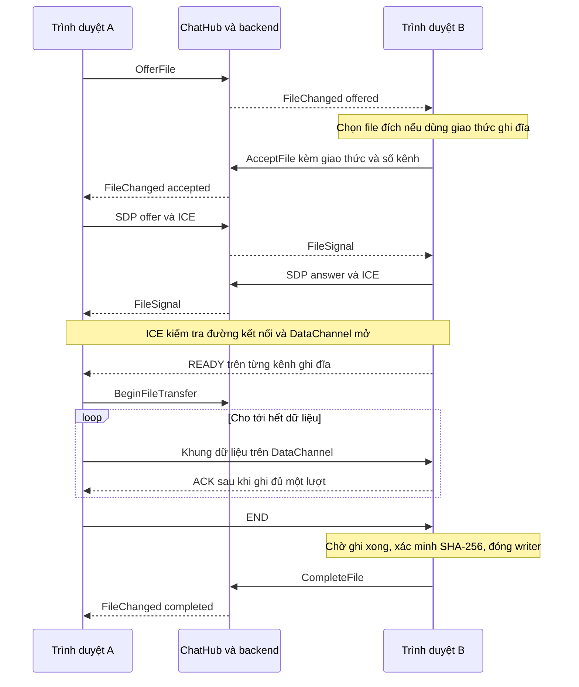
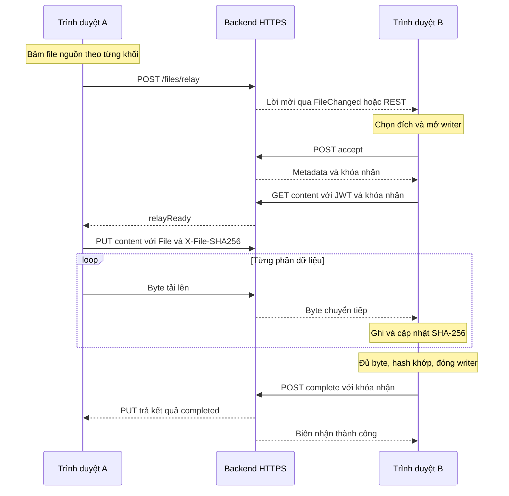

# Đặc tả truyền file của Wiremess

Đối chiếu mã nguồn nhánh `main` tại commit `a539676`, bổ sung lựa chọn
mặc định trong working tree ngày 21/11/2026 (chưa commit). Trong tài liệu này,
**A** là người gửi, **B** là người nhận. Một lần gửi tạo một phiên trong
`FileTransfers` và một thẻ tệp trong cuộc trò chuyện giữa hai người.

[Luồng WebRTC](#3-truyền-bằng-webrtc) · [Luồng HTTPS](#4-chuyển-tiếp-trực-tiếp-bằng-https)
· [Quản lý phiên](#6-quản-lý-phiên-quyền-và-thời-gian-chờ) · [Cơ sở dữ liệu](#7-cơ-sở-dữ-liệu-và-lịch-sử)
· [Số đo](#13-kiểm-thử-và-số-đo-đã-ghi-nhận)

## 1. Phạm vi và thao tác trên giao diện

Wiremess hỗ trợ truyền file giữa hai trình duyệt đã đăng nhập. Hai người cần
có cuộc trò chuyện. Bản web dùng WebRTC cho đường truyền ưu tiên và HTTPS
cho đường chuyển tiếp trực tiếp qua backend.

| Thao tác | Đường đi của nội dung file | Dùng khi |
| --- | --- | --- |
| **Gửi file** trong **Trò chuyện** hoặc **Gửi lời mời** trong **Tệp** | A → B qua WebRTC DataChannel. ICE có thể chọn đường trực tiếp hoặc đường qua TURN. | Hai tab có thể thiết lập WebRTC. |
| **Gửi qua máy chủ** | A tải lên qua HTTPS, backend chuyển từng phần sang luồng tải của B. | Muốn dùng HTTPS ngay từ đầu hoặc mạng khó kết nối WebRTC. |
| Tự chuyển khi WebRTC lỗi | App đưa phiên WebRTC đang hoạt động sang HTTPS và gửi lại từ byte đầu trên cùng thẻ. | Phiên dùng giao thức ghi đĩa và gặp lỗi kết nối thuộc nhóm được chuyển tiếp. |

1. Mở cuộc trò chuyện và chọn thao tác gửi. Trong trang **Tệp**, chọn người
   nhận qua cuộc trò chuyện rồi chọn file. File trên **1.073.741.824 byte**
   cần xác nhận bằng **Tiếp tục gửi**.
2. Đợi thẻ tệp xuất hiện. B chọn **Nhận file** trong **Trò chuyện** hoặc
   **Chấp nhận** trong **Tệp**. Ở chế độ ghi đĩa, trình duyệt mở hộp **Lưu
   thành** để B chọn một file đích và cấp quyền ghi.
3. Giữ hai tab mở trong lúc truyền. Có thể đổi giữa các trang trong ứng
   dụng. A có **Hủy gửi** khi chờ nhận. B có **Từ chối** trong lúc còn lời
   mời. Hai đầu đang xử lý có **Hủy** khi phiên còn hoạt động.
4. Theo dõi thẻ đến khi B lưu xong và máy chủ ghi nhận phiên hoàn tất. Với
   cách nhận cũ **Nhận để tải xuống**, B bấm **Tải xuống** để lấy file từ
   bộ nhớ của tab.

| Giới hạn | Giá trị hiện tại |
| --- | ---: |
| Mỗi file | 10.737.418.240 byte, khoảng **10.737,4 MB** |
| Ngưỡng hỏi lại ở máy gửi | Lớn hơn 1.073.741.824 byte, khoảng **1.073,7 MB** |
| WebRTC `file-v1` và `file-v2` | 104.857.600 byte, khoảng **104,9 MB** |
| Mặc định WebRTC | File nhỏ dùng một kết nối; file trên khoảng 104,9 MB ưu tiên hai kết nối riêng khi được hỗ trợ. |
| WebRTC thủ công | Chế độ nhà phát triển cho chọn 1–8 kênh trên một kết nối hoặc hai kết nối riêng. |
| Vùng đệm payload do backend cấp cho một phiên HTTPS | Tối đa **4 MB**, tính theo 4.000.000 byte. |

Giao diện hiển thị theo hệ thập phân. `1 KB = 1.000 byte` và
`1 MB = 1.000.000 byte`. App cho phép file 0 byte. Chế độ ghi đĩa cần
ngữ cảnh bảo mật như HTTPS hoặc localhost, cùng `showSaveFilePicker` và
`FileSystemFileHandle.createWritable` ở máy B.

## 2. Thành phần và trách nhiệm

| Thành phần | Trách nhiệm |
| --- | --- |
| Trình duyệt A | Giữ đối tượng `File` từ picker, tạo lời mời, tính SHA-256 nguồn và cung cấp từng phần dữ liệu. |
| Trình duyệt B | Chấp nhận lời mời, ghi file, tính SHA-256 từ dữ liệu nhận được và gửi xác nhận. |
| SignalR `ChatHub` | Nhận lệnh phiên WebRTC, trao đổi SDP và ICE, phát `FileChanged` cho các kết nối hợp lệ của A và B. |
| REST API | Cấp cấu hình, tra lịch sử và điều khiển phiên HTTPS. Hai request HTTP riêng chuyển byte của phiên HTTPS. |
| `FileTransferService` | Kiểm tra thành viên, quyền của từng đầu, trạng thái và giới hạn phiên. Giữ registry phiên đang chạy và cập nhật SQL. |
| `FileRelayPipe` | Đọc luồng tải lên và chuyển byte theo thứ tự sang luồng tải xuống bằng vùng đệm hữu hạn. |
| SQL Server | Lưu định danh, cuộc trò chuyện, tên file, kích thước, SHA-256, thời gian và trạng thái. |
| Nginx | Nhận HTTPS, phục vụ frontend, chuyển API và WebSocket đến .NET. Route truyền byte có cấu hình streaming riêng. |

Với WebRTC, SignalR và SQL xử lý thông tin phiên. Byte file đi qua
DataChannel. Khi ICE chọn TURN, TURN chuyển tiếp lưu lượng WebRTC. Trên
AWS, hai luồng nội dung HTTPS đi tới Nginx qua TLS. Nginx chuyển tiếp
vào backend qua loopback. Lịch sử mở lại từ SQL phục vụ xem thông tin và
kết quả phiên.

## 3. Truyền bằng WebRTC



Sơ đồ mô tả các giao thức ghi đĩa từ `file-v2` trở lên. B mở writer trước
khi gửi `AcceptFile`. Hub chốt giao thức đã đề nghị và gắn phiên với
`ConnectionId` của hai đầu. `BeginFileTransfer` chỉ hợp lệ khi backend đã
thấy SDP answer của mọi kết nối tham gia. Nếu A băm trong lúc truyền, A
gọi `FinalizeFileHash` trước các khung `END`.

**SDP** mô tả đề nghị và phản hồi thiết lập WebRTC. **ICE** trao đổi các
địa chỉ và cổng ứng viên rồi kiểm tra từng cặp đường kết nối. STUN giúp
phát hiện địa chỉ được NAT ánh xạ ra ngoài. TURN cung cấp địa chỉ chuyển
tiếp khi cần. Trình duyệt lấy danh sách máy chủ ICE từ
`GET /api/v1/files/configuration`. [Quy trình ICE](https://www.rfc-editor.org/rfc/rfc8445.html#section-2)

### Các phiên bản giao thức

| Giao thức | Định dạng và cách nhận | Cách A tính SHA-256 |
| --- | --- | --- |
| `file-v1` | Một kênh. Header 4 byte chứa số thứ tự khối. B ghép các khối thành `Blob` để tải xuống. | Tính trước lời mời. |
| `file-v2` | Một kênh ghi đĩa. Header 4 byte chứa vị trí byte `uint32`. | Tính trước lời mời. |
| `file-v3` | Một kênh ghi đĩa. Header 8 byte chứa vị trí byte `uint64`, dùng được khi file vượt 4.294.967.296 byte. | Tính trước lời mời. |
| `file-v4` | Một kênh, header 8 byte. Dùng cho file lớn khi có Web Worker và DB cho phép chốt hash sau. | Băm theo lô trong lúc truyền. |
| `file-v5` | Từ 1 đến 8 DataChannel trên một `RTCPeerConnection`, header 8 byte. | Dùng hash đã tính hoặc băm trong lúc truyền nếu lời mời file lớn hỗ trợ chốt sau. |
| `file-v6` | Hai `RTCPeerConnection`, mỗi kết nối một DataChannel, header 8 byte. | Cùng cơ chế hash với v5. |

Với file trong giới hạn cũ, A đề nghị v1 và v2. Với file lớn, giao thức một
kênh là v4 khi trình duyệt có `Worker` và API báo `supportsDeferredHash`;
trường hợp còn lại dùng v3. Backend xác định khả năng chốt hash muộn qua
tính nullable của cột `Sha256`.

Khi chế độ nhà phát triển tắt, file lớn tự đề nghị v6/v5 trước giao thức
một kênh nếu máy chủ có `supportsParallelFileConnections: true` và hỗ trợ
ít nhất hai kênh. Nếu thiếu khả năng này, A giữ một kết nối. B chốt một
phương án mà A đã đề nghị. Chế độ nhà phát triển giữ ưu tiên cấu hình
thủ công của người dùng. Cơ chế này chưa tự đo băng thông để đổi cấu hình
giữa phiên; số đo local không bảo đảm tốc độ trên LAN/TURN.

Để thử nhiều kênh, mở **Cài đặt** → **Nhà phát triển** → **Kích hoạt chế độ
nhà phát triển** → **Số kênh truyền file**. Công tắc **Hai kết nối WebRTC
riêng** chọn v6 với hai kênh nếu máy chủ hỗ trợ. Cấu hình có hiệu lực từ
lời mời tiếp theo và lưu ở trình duyệt.

### Chia khối, điều tiết và ghép file

- Mỗi khung dữ liệu chứa tối đa **16.384 byte** nội dung. Header số thứ tự
  hoặc vị trí byte ghi theo big-endian. Với v1, A kết thúc bằng gói JSON
  `{"type":"end"}`. Với v2 trở lên, gói điều khiển `READY`, `ACK` và `END`
  mang ID phiên và chỉ số kênh. `ACK` còn chứa tổng byte liên tiếp đã ghi.
- Ở v5 và v6, khối số `i` đi qua kênh `i % channelCount`. Mỗi kênh tin cậy
  và có thứ tự. Các kênh có thể đến xen kẽ. B kiểm tra vị trí dự kiến
  trên từng kênh và kích thước khối. B giữ khối đến sớm trong cửa sổ chung
  và đưa dải byte liên tiếp vào cùng một writer.
- V2 và v3 có cửa sổ **524.288 byte** chưa được ACK. B báo ACK mỗi
  **65.536 byte** đã ghi hoặc khi ghi hết. V4, v5 và v6 có cửa sổ chung
  **2.097.152 byte** và gom mỗi lượt ghi tối đa **262.144 byte**. ACK của
  phiên đi trên kênh 0. A chờ ACK khi bước gửi tiếp theo sẽ vượt cửa sổ.
- A còn theo dõi `bufferedAmount` của DataChannel để chờ hàng đợi gửi có
  chỗ trống. V1 đến v3 dùng mốc kiểm tra 262.144 byte. V4 đến v6 chia
  ngưỡng 1.048.576 byte cho số kênh đang dùng. Tiến độ WebRTC ghi đĩa của
  A dựa trên ACK. Tiến độ của B tăng sau khi `write()` thành công. Với v1,
  A đếm số byte đã đưa vào kênh và B đếm số byte đã nhận vào bộ nhớ.
- V5 và v6 chờ `READY` và `END` trên mọi kênh. B kiểm tra đủ số byte, chờ
  hàng đợi ghi hoàn thành, chờ thông tin SHA-256 nguồn rồi xác minh. Một
  SHA-256 bao phủ toàn bộ dữ liệu theo đúng thứ tự byte.

Nhiều DataChannel của v5 dùng chung cửa sổ điều tiết nghẽn của liên kết
SCTP. V6 thử hai kết nối riêng, còn tốc độ thực tế phụ thuộc đường mạng,
CPU và ổ ghi. Số kênh phù hợp là kết quả đo với cùng file và cùng đường
truyền. [Điều tiết nghẽn SCTP trong WebRTC](https://www.rfc-editor.org/rfc/rfc8831.html#section-5)

## 4. Chuyển tiếp trực tiếp bằng HTTPS

### Tạo lời mời và chuyển byte



Ở lượt gửi HTTPS từ đầu, A tính xong hash trước khi tạo thẻ. Khi B chấp
nhận, backend cấp `receiverKey`. B mở `GET /content`; service kiểm tra
JWT, quyền của B và `X-File-Relay-Key` rồi đặt `relayReady`. A còn giữ
`File` nguồn mới mở `PUT /content`. Backend kiểm tra `Content-Length` và
`X-File-SHA256` theo metadata trước khi bắt đầu chuyển byte.

Hai request dùng `application/octet-stream`. Phản hồi tải xuống mang
`Content-Length` và `X-File-SHA256`. Ở phiên đã chuyển hết byte, `PUT`
tiếp tục chờ kết quả cuối của B. Backend chỉ chốt `completed` sau khi
luồng tải xuống đã chuyển hết dữ liệu và biên nhận có đúng số byte và
SHA-256. Biên nhận là xác nhận cho cả file.

### Vùng đệm tại máy chủ

`FileRelayPipe` cấp một vùng **3.968.000 byte**, chia thành 62 ô đệm, mỗi
ô 64.000 byte. Luồng đọc lấy một ô trống, đọc tối đa **64 KB** hoặc số
byte còn lại rồi đưa số byte vừa đọc vào hàng chờ ghi. Luồng ghi chuyển
phần đó cho B và trả ô về danh sách trống sau khi ghi và `FlushAsync()`
thành công. B có thể nhận phần đầu khi A còn tải phần sau.

Nếu các ô đều bận, lượt đọc tiếp chờ một ô trống. Đây là cơ chế điều tiết
khi B hoặc đường tải xuống chậm. Vùng payload do ứng dụng giữ có trần
cố định theo phiên dù dung lượng file tăng. Với tối đa 16 phiên đã
cấp đệm, các vùng payload đang hoạt động chiếm tối đa **63.488.000 byte**.
Kestrel, Nginx, TCP và trình duyệt còn có các vùng đệm riêng. Nội dung phiên
đi qua RAM của backend. SQL lưu thông tin và kết quả phiên.

### Chuyển từ WebRTC sang HTTPS

App có thể chuyển khi một phiên ghi đĩa đang hoạt động gặp lỗi thiết lập
WebRTC, kênh đóng, hoặc hết thời gian chờ tiến độ và máy chủ còn giữ phiên.
A hoặc B gửi `POST /files/{id}/relay` bằng phiên đăng nhập đã gắn với
lượt WebRTC. Backend đưa phiên về `offered` với `transport = https` và
giữ nguyên ID thẻ. Client dọn peer và writer WebRTC, rồi mở writer HTTPS
bằng file đích B đã chọn nếu handle còn dùng được. Dữ liệu bắt đầu lại từ
byte đầu. A dùng SHA-256 đã chốt, hoặc băm trước khi tải nếu hash còn trống.

HTTPS dùng `FileChanged` để đồng bộ nhanh khi có SignalR. Frontend vẫn
đọc trạng thái phiên HTTPS đang hoạt động qua REST khoảng mỗi giây. Khi
SignalR ngắt, app đọc trang tệp gần nhất để phát hiện lời mời HTTPS và
dùng API theo ID để theo dõi các phiên đã biết. Vì vậy nút **Gửi qua máy
chủ** dùng được cả khi kênh báo hiệu WebRTC gặp sự cố.

## 5. SHA-256, giữ RAM thấp và lưu file

### Tại máy gửi

Hàm `hashFile()` dùng `@noble/hashes` để băm gia tăng. A chọn từng khoảng
**1.048.576 byte** bằng `File.slice()`, nạp khoảng đó bằng `arrayBuffer()`
rồi đưa byte vào `hash.update()`. Vòng lặp xử lý lần lượt và bỏ tham chiếu
đến khối cũ để runtime có thể thu hồi bộ nhớ. Trạng thái hash có kích
thước cố định. Cuối file, `digest()` trả 32 byte, biểu diễn bằng **64 ký
tự hex** trong API. File 4.000 MB cần khoảng 3.815 lượt đọc ở khâu này.
[File API của trình duyệt](https://www.w3.org/TR/FileAPI/#blob-section)

Ở WebRTC có chốt hash muộn, `fileHashWorker.js` đọc và băm từng lô
**524.288 byte**. Worker chuyển quyền sở hữu `ArrayBuffer` cho luồng gửi.
App duy trì một lô đang gửi và tối đa một lô đọc trước. Khi đường truyền
bị chậm, worker chờ yêu cầu cho lô mới. Băm theo cách này cho phép A tạo
lời mời trước, rồi băm cùng lúc với gửi. Ở HTTPS từ đầu, lượt băm trước
lời mời và lượt tải lên là hai lượt đọc logic riêng.
[Cơ chế chuyển quyền sở hữu buffer](https://html.spec.whatwg.org/multipage/structured-data.html#transferable-objects)

### Tại máy nhận

`createFileStorage()` mở writer ở chế độ `exclusive`. Mỗi lượt ghi kiểm
tra offset và dung lượng. B gọi `hash.update()` với phần byte vừa ghi
thành công. Cuối phiên, B kiểm tra số byte và so SHA-256 với hash A đã
khai báo. B đóng writer sau khi xác minh và chỉ gửi biên nhận sau khi
đóng thành công. Nếu hash sai, vị trí sai, ghi lỗi hoặc bị hủy, app hủy
writer chưa chốt.

`file-v1` ghép file trong bộ nhớ và băm `Blob` để đối chiếu trước khi tạo
URL **Tải xuống**. Tab giữ tối đa hai URL tệp tải được. Nút **Giải phóng
tệp** hoặc việc đóng tab kết thúc khả năng tải từ những URL tạm đó.

### Tên và vị trí lưu

B cấp quyền ghi một file đích trong hộp **Lưu thành**. Nơi lưu phụ thuộc
quyền hệ điều hành và thư mục mà trình duyệt cho phép chọn. App làm sạch
tên gợi ý cho Windows, giữ đuôi nguồn và kiểm tra cả tên mà picker trả
về. Ví dụ `A.mp3` có thể lưu thành `Bản thu.mp3`. Khi picker trả tên đuôi
`.exe` cho nguồn `.mp3`, app báo sai đuôi và B chọn lại khi còn lời mời.

Trình duyệt có thể dùng vùng ghi tạm cạnh file đích và công bố dữ liệu
khi writer đóng. Chrome có thể tạo placeholder rỗng ngay lúc chọn đích.
Nếu B chọn ghi đè, tác động của picker lên file cũ có thể xảy ra trước
khi app bắt đầu ghi. Muốn giữ file cũ, chọn tên đích khác. Kết quả xác
minh thể hiện tính toàn vẹn byte so với file A đã chọn.
[File System API và `createWritable`](https://fs.spec.whatwg.org/#dom-filesystemfilehandle-createwritable)

## 6. Quản lý phiên, quyền và thời gian chờ

### Vòng đời phiên

| Trạng thái SQL | Khi nào xuất hiện |
| --- | --- |
| `offered` | A tạo lời mời. Khi một phiên chuyển từ WebRTC sang HTTPS, backend dùng lại ID và đưa thẻ về trạng thái này. |
| `accepted` | B chấp nhận. Backend chọn đầu nhận và bắt đầu chờ kết nối hoặc chờ mở các luồng HTTPS. |
| `transferring` | A gọi `BeginFileTransfer` thành công trên WebRTC hoặc mở `PUT /content` hợp lệ trên HTTPS. Trạng thái này bao gồm thời gian chờ B lưu và xác nhận. |
| `completed` | B xác nhận đủ số byte và SHA-256 khớp. Với ghi đĩa, B gửi xác nhận sau khi writer đóng thành công. |
| `rejected` | B từ chối khi lời mời còn `offered`. |
| `cancelled` | Một đầu có quyền hủy lúc phiên còn hoạt động. |
| `failed` | Phiên đang kết nối hoặc truyền gặp lỗi, ngắt luồng hoặc hết hạn. Client cũng có thể báo thất bại khi ghi, kiểm tra dữ liệu hoặc xác minh hash gặp lỗi. |
| `expired` | Worker chốt một lời mời còn `offered` đã hết thời gian chờ hoặc mất điều kiện để tiếp tục. |

`offered`, `accepted` và `transferring` là ba trạng thái đang hoạt động.
Khi kết thúc, backend ghi `FinishedAt` rồi bỏ mục tương ứng khỏi registry.
Frontend dọn DataChannel, writer, timer và tham chiếu đến file nguồn của
phiên. Một lượt gửi mới có `ClientTransferId` mới và bắt đầu từ byte đầu.

### Phân quyền và thao tác đồng thời

- Backend đọc người dùng từ JWT. `ConversationId` phải thuộc cuộc trò
  chuyện có A và B. Từ `SenderId`, server xác định người nhận là thành
  viên còn lại. Lịch sử chi tiết và thông tin phiên chỉ trả cho thành
  viên có quyền.
- Khi tạo lời mời, backend kiểm tra kích thước và tên nguồn. Tên cần có
  nội dung, dài tối đa 255 ký tự và bị từ chối nếu có ký tự điều khiển
  hoặc dấu phân tách đường dẫn.
- Lời mời WebRTC cần B có kết nối hợp lệ trong hệ thống presence. WebRTC
  gắn phiên với `ConnectionId` của A và tab B đã chấp nhận. Tin SDP/ICE đi
  tới đúng kết nối của bên kia. Các tab hợp lệ khác của hai tài khoản có
  thể nhận metadata để hiển thị thẻ.
- HTTPS gắn quyền thực hiện với tài khoản, `sid` của phiên đăng nhập và
  trạng thái. B nhận thêm khóa ngẫu nhiên **24 byte**, biểu diễn bằng
  48 ký tự hex. Mỗi phiên có một `GET /content` và một `PUT /content`
  được chấp nhận. `GET` của B kiểm tra cả JWT lẫn khóa nhận.
- `FileTransferService` tuần tự hóa thay đổi phiên bằng `SemaphoreSlim`.
  Hành động WebRTC và chấp nhận HTTPS so `ExpectedVersion` với phiên bản
  hiện tại của bản ghi. Nếu hai tab cùng bấm nhận, lượt hợp lệ đầu tiên
  chốt phiên. Lượt còn lại nhận lỗi xung đột hoặc lỗi phiên bản.
  Luồng đọc và ghi payload HTTPS chạy ngoài vùng khóa này.
- Chỉ A có quyền đưa hoặc chốt hash nguồn. Chỉ đầu nhận mới có quyền xác
  nhận hoàn tất. Biên nhận HTTPS xác thực bằng khóa đã cấp cho phiên sống,
  chờ luồng ra tải hết, rồi đối chiếu `TransferId`, số byte, hash và hai
  tài khoản. Khóa mất hiệu lực khi registry kết thúc phiên.

### Hạn mức và thời gian

| Phạm vi | Mốc hiện tại |
| --- | --- |
| Bộ quản lý ở tab gửi | Tối đa 2 file do tab đang giữ để chuẩn bị hoặc gửi. |
| Mỗi tài khoản ở backend | Tối đa 2 phiên đang chờ hoặc chạy, tính cả vai trò gửi và nhận. |
| Registry của một backend | Tối đa 1.000 phiên đang hoạt động. Tối đa 16 phiên HTTPS đã bắt đầu và cấp vùng đệm payload. |
| WebRTC chờ lời mời | 60 giây. |
| WebRTC sau khi B chấp nhận | 45 giây chờ thiết lập. |
| WebRTC sau `BeginFileTransfer` | Backend đặt hạn 30 phút. Client thường phát hiện mất tiến độ sau 60 giây. Chờ bộ đệm DataChannel có timeout 30 giây. |
| HTTPS chờ lời mời hoặc đang truyền | Thường dừng sau 60 giây nhàn rỗi. Mốc đo được cập nhật khi backend chuyển byte. |
| HTTPS sau khi B mở `GET`, trước lúc A bắt đầu `PUT` | Tối đa 300 giây kể từ khi B sẵn sàng. Khoảng này dành cho việc chuẩn bị ở A, gồm trường hợp phải băm lại khi chuyển từ WebRTC. |
| Dọn phiên định kỳ | `FileTransferMonitor` quét mỗi 5 giây. Backend WebRTC cũng kiểm tra khi một kết nối SignalR ngắt. |

JWT hiện có thời hạn 30 phút tính từ đăng nhập. Các request HTTPS xác
thực khi mở. Với job HTTPS đang hoạt động, frontend hoãn thoát màn hình
cho đến khi job kết thúc. Biên nhận dùng khóa riêng của phiên nên vẫn có
thể hoàn tất nếu JWT hết hạn sau khi hai luồng nội dung đã mở. Một lượt
gửi mới cần đăng nhập còn hiệu lực. Chủ động đăng xuất hoặc tài khoản bị
khóa sẽ kết thúc phiên liên quan.

Registry hoạt động trên một tiến trình backend. Khi backend khởi động
lại, worker xử lý bản ghi đang dở bằng `expired` cho lời mời và `failed`
cho phiên đang kết nối hoặc truyền. B có thể giữ file đã đóng thành công
dù app mất phản hồi xác nhận. Giao diện hiện **Đã lưu trên máy, chưa xác
nhận với máy chủ** trong tình huống này.

## 7. Cơ sở dữ liệu và lịch sử

### Bảng `FileTransfers`

| Cột | Kiểu SQL | Vai trò |
| --- | --- | --- |
| `Id` | `BIGINT IDENTITY` | Khóa chính của phiên, dùng cho thẻ tệp, API và sự kiện. |
| `ClientTransferId` | `UNIQUEIDENTIFIER` | UUID do tab A tạo để nhận diện một thao tác gửi. |
| `ConversationId` | `BIGINT` | Khóa ngoại đến `DirectConversations.Id`. Dùng để gắn thẻ vào đúng chat và tra quyền thành viên. |
| `SenderId` | `INT` | Khóa ngoại đến `Users.Id`. B được suy ra từ `UserAID` và `UserBID` của cuộc trò chuyện. |
| `FileName` | `NVARCHAR(255)` | Tên file nguồn dùng trên thẻ và làm gợi ý tên đích. |
| `FileSizeBytes` | `BIGINT` | Kích thước khai báo theo byte, đối chiếu đến khi hoàn tất. |
| `Sha256` | `VARBINARY(32) NULL` | Hash nguồn. Có thể để trống trong lúc WebRTC chuẩn bị chốt hash muộn. |
| `VerifiedSha256` | `VARBINARY(32) NULL` | Hash nhận được từ biên nhận của B khi hoàn tất. |
| `Status` | `VARCHAR(12)` | Một trong tám trạng thái ở mục vòng đời. |
| `CreatedAt`, `AcceptedAt`, `FinishedAt` | `DATETIME2(3)` | Giờ UTC của các bước trong phiên. Hai mốc sau có thể để trống tùy trạng thái. |
| `RowVersion` | `ROWVERSION` | Phiên bản chống thao tác dựa trên metadata cũ. API gửi thành chuỗi Base64. |

DB đặt `UNIQUE (SenderId, ClientTransferId)`. Khi A lặp một lời mời với
cùng UUID và metadata phù hợp, service trả lại phiên cũ. Nếu metadata
đã đổi, service báo xung đột mã truyền. Điều kiện hoàn tất yêu cầu
`VerifiedSha256` khớp `Sha256`. Schema còn kiểm tra trạng thái, thứ tự
thời gian và tư cách thành viên của người gửi. Cơ sở dữ liệu cũ có thể
áp dụng migration chốt hash muộn để cho phép `Sha256` nhận `NULL`.
[Schema SQL](../database/01_schema.sql) · [Migration hash](../database/migrations/003_deferred_file_hash.sql)

### Xem lại trong chat và trang Tệp

Trang **Tệp** lấy lịch sử của tài khoản. Chat lấy file theo đúng
`ConversationId`, ghép với tin nhắn theo thời gian UTC. Cả hai dùng cùng
ID phiên và tải tối đa 50 bản ghi mỗi trang. `beforeId` lấy các phiên có
ID nhỏ hơn. `nextCursor` là ID để lấy trang kế tiếp. ID `BIGINT` được gửi
dưới dạng chuỗi để JavaScript giữ đúng giá trị. `FileChanged` cập nhật
thẻ và thông tin tệp gần nhất của cuộc trò chuyện.

SQL giữ lịch sử metadata và các mốc kết quả. Trong thời gian phiên sống,
registry bổ sung `transport`, `protocolVersion`, `channelCount`,
`relayReady` và `relayedBytes`. Sau khi mở lại lịch sử từ SQL, các nhãn
đường truyền và tiến độ tạm chỉ xuất hiện nếu frontend còn dữ liệu phiên
hoặc server còn registry tương ứng. Để mở nội dung một phiên đã xong,
B dùng file đã lưu trên máy. Trường hợp cần nhận lại byte, tạo lượt gửi mới.

## 8. REST API, SignalR và dữ liệu trao đổi

### REST API

| Method và đường dẫn | Tác dụng |
| --- | --- |
| `GET /api/v1/files/configuration` | Trả giới hạn file, giới hạn cũ, số kênh, danh sách ICE, khả năng chốt hash muộn, hai kết nối WebRTC và HTTPS relay. |
| `GET /api/v1/files?beforeId=…` | Trang lịch sử file của tài khoản. |
| `GET /api/v1/conversations/{conversationId}/files?beforeId=…` | Trang file của cuộc trò chuyện mà người gọi là thành viên. |
| `GET /api/v1/files/{id}` | Metadata một phiên, kèm dữ liệu runtime nếu phiên còn hoạt động. |
| `POST /api/v1/files/relay` | Tạo lời mời HTTPS bằng `OfferFileDto`. |
| `POST /api/v1/files/{id}/relay` | Chuyển phiên WebRTC đang hoạt động sang HTTPS trên cùng ID. |
| `POST /api/v1/files/{id}/relay/accept` | B nhận lời mời bằng `FileActionDto`. Kết quả gồm `transfer` và `receiverKey`. |
| `GET /api/v1/files/{id}/relay/content` | B mở luồng nhận với JWT và header `X-File-Relay-Key`. |
| `PUT /api/v1/files/{id}/relay/content` | A tải `File` lên với JWT, `Content-Length` và `X-File-SHA256`. |
| `POST /api/v1/files/{id}/relay/complete` | B gửi `CompleteFileDto` và `X-File-Relay-Key` sau khi lưu. Endpoint xác thực bằng khóa biên nhận. |
| `DELETE /api/v1/files/{id}/relay?action=…` | Kết thúc sớm với `cancel`, `reject` hoặc `fail`, tùy vai trò và trạng thái. Mặc định là `cancel`. |

`401` báo thiếu hoặc hết hiệu lực thông tin xác thực JWT ở route cần
đăng nhập. `403` thường báo sai quyền đầu gửi, đầu nhận hoặc khóa biên
nhận. `404` dùng khi thành viên không tìm thấy phiên có quyền xem.
`409` báo phiên đã đổi, bị ngắt hoặc hết hiệu lực. `503` có thể xuất hiện
khi đủ 16 phiên HTTPS đã cấp đệm. Body sai dung lượng hoặc hash bị từ
chối với `400`. Nếu luồng tải đã phát header rồi phát sinh lỗi, backend
ngắt response và client phát hiện lần tải bị dở.

### Lệnh client gọi `ChatHub`

| Phương thức | Vai trò và dữ liệu chính |
| --- | --- |
| `OfferFile` | A gửi `OfferFileDto`. Kết quả là `FileTransferDto`. |
| `AcceptFile` | B gửi `FileActionDto` với `ProtocolVersion` và `ChannelCount`. |
| `SendFileSignal` | Hai đầu trao đổi `FileSignalDto` với `Kind` là `offer`, `answer` hoặc `ice`, đi theo `ConnectionIndex`. |
| `BeginFileTransfer` | A thông báo bắt đầu phiên bằng `FileActionDto` sau thiết lập kênh. |
| `FinalizeFileHash` | A chốt SHA-256 bằng `FinalizeFileHashDto`. Các phiên v4, v5, v6 có thể dùng bước này. |
| `CompleteFile` | B xác nhận số byte và hash bằng `CompleteFileDto`. |
| `RejectFile`, `CancelFile`, `FailFile` | Từ chối, hủy hoặc báo lỗi với `FileActionDto`. `FailFile` nhận mã lỗi thuộc tập cho phép. |
| `ReportFileObservation` | Endpoint WebRTC báo giai đoạn và tiến độ để giám sát bằng `FileObservationDto`. |

Hub chuyển `FileChanged(FileTransferDto)` để cập nhật thẻ và trạng thái.
`FileSignal(FileSignalDto)` đi tới đúng endpoint WebRTC của bên kia.
Backend giới hạn SDP ở 24.000 ký tự. ICE tối đa 4.096 ký tự mỗi payload
và 128 candidate mỗi phía trên mỗi kết nối. V6 dùng `ConnectionIndex`
bằng 0 hoặc 1 để ghép báo hiệu vào đúng `RTCPeerConnection`.

### DTO dùng khi lập trình

| DTO | Trường chính |
| --- | --- |
| `OfferFileDto` | `conversationId`, `clientTransferId`, `fileName`, `fileSizeBytes`, `sha256Hex`, `supportedProtocols`, `requestedChannelCount`. |
| `FileActionDto` | `transferId`, `expectedVersion`, có thể kèm `failureCode`, `protocolVersion`, `channelCount`. |
| `FinalizeFileHashDto` | `transferId`, `expectedVersion`, `sha256Hex`. |
| `FileSignalDto` | `transferId`, `kind`, `payload`, `connectionIndex`. |
| `CompleteFileDto` | `transferId`, `expectedVersion`, `receivedBytes`, `verifiedSha256Hex`. |
| `FileObservationDto` | `transferId`, `stage`, `bytes`, `reason`. Hai trường sau có thể để trống. |
| `FileTransferDto` | ID, A/B, thông tin tệp và hash, trạng thái, thời gian, `version`, endpoint, giao thức và dữ liệu relay. |
| `FileRelayAcceptanceDto` | `transfer` và `receiverKey`. |
| `FilePageDto` | `items` và `nextCursor`. |

Các trường dưới dạng JSON dùng camelCase. A gửi `sha256Hex` là chuỗi
64 ký tự hex. WebRTC chốt hash muộn cho phép `sha256Hex` là `null` ở lời
mời. Client lấy `expectedVersion` từ `version` của metadata mới nhất
khi gọi lệnh cần kiểm tra phiên bản. Biên nhận HTTPS dựa trên khóa nhận,
phiên đang sống, số byte và hash ở bước kiểm tra cuối.
[Định nghĩa các DTO](../PBL4/Contracts/FileDtos.cs)

## 9. Bộ quản lý ở frontend

`FileTransferProvider` tạo bộ quản lý theo phiên đăng nhập và cung cấp
cùng trạng thái cho **Trò chuyện** và **Tệp**. Việc chuyển trang trong
ứng dụng dùng lại provider. Bộ quản lý theo dõi file nguồn, peer WebRTC,
writer ở B, job HTTPS và link tải tạm theo ID. Callback `changed()` đối
chiếu phiên bản metadata, cập nhật đúng một thẻ, rồi phát snapshot cho
giao diện.

| Nhóm hàm | Hàm chính | Vai trò |
| --- | --- | --- |
| Quản lý kết nối và tài nguyên | `setConnection`, `startPeer`, `createPeer`, `attachChannel`, `pollRelay`, `releasePeer`, `releaseRelay`, `dispose` | Đăng ký Hub listener, tạo kênh, mở hoặc dọn luồng, tải trạng thái bù qua REST. |
| Nhận sự kiện từ server | `changed`, `signalReceived` | Nhận `FileChanged` và `FileSignal`, cập nhật thẻ, ghép SDP/ICE vào đúng kết nối và khởi động bước truyền kế tiếp. |
| Chủ động xử lý nghiệp vụ | `offer`, `action`, `acceptRelay`, `sendFile`, `uploadRelay`, `receiveRelay`, `endRelay` | Gửi lời mời, nhận, truyền nội dung, xác nhận, từ chối, hủy và báo lỗi. |
| Đọc lịch sử và giải phóng link | `load`, `loadConversation`, `forgetDownload` | Lấy các trang mới hoặc cũ, thu hồi URL tệp v1. |

Ở HTTPS, phía A hiển thị số byte backend đã chuyển ra qua
`relayedBytes`. Phía B hiển thị số byte writer đã nhận thành công. Đây
là hai mốc khác nhau trong luồng. `bytesPerSecond` dùng số byte và thời
gian kể từ lúc bắt đầu theo bộ đếm phía client. Thanh tiến độ có thể đạt
100% trong lúc thẻ còn **Đang xác minh SHA-256…** hoặc **Đang lưu vào vị
trí đã chọn…**.

## 10. Giám sát truyền file ở trang Quản trị

Mục **Phiên truyền file** trong màn giám sát hiển thị ID phiên, A/B,
kích thước, trạng thái và mốc thời gian. Trang lấy dữ liệu từ
`GET /api/v1/admin/monitoring?beforeFileId=…`. API yêu cầu role `Admin`,
phân trang tối đa 50 phiên và giới hạn 60 request mỗi phút theo người
dùng xác thực. Metadata của phiên lấy từ SQL. Timeline kỹ thuật ghép
các sự kiện của ID đó trong bộ đệm giám sát.

Sự kiện file mang `TransferId`, nguồn (`backend`, `client-A` hoặc
`client-B`), giai đoạn, số byte nếu có, mã lý do và timestamp từ server.
Backend ghi các bước trạng thái của cả hai đường truyền. Với WebRTC,
client còn báo `channel-open`, `transferring`, `verifying` và lỗi phù
hợp. Server xác nhận endpoint, chặn báo cáo bị lùi giai đoạn hoặc sai số
byte. Báo cáo cùng giai đoạn cách nhau tối thiểu 5 giây. Hub giới hạn
tối đa 8 báo cáo trong cửa sổ 5 giây trên mỗi kết nối.

Các mã phổ biến gồm `HASH_MISMATCH`, `INVALID_CHUNK`, `WEBRTC_FAILED`,
`TRANSFER_TIMEOUT` và `UNKNOWN`. Mã do client báo thể hiện quan sát phía
client. Backend có mã riêng khi phát hiện mất kết nối, lời mời hết hạn,
tài khoản bị vô hiệu hóa hoặc registry mất sau restart. Với HTTPS, xem
kết hợp trạng thái phiên, mã HTTP và số byte chuyển tiếp để tìm chặng
đang dừng. Thời gian của `PUT` có cả phần chờ biên nhận cuối từ B.

`MonitoringService` giữ tối đa **5.000 sự kiện file trong 24 giờ**. API
giám sát trả tối đa 500 sự kiện thuộc trang file hiện tại. Worker ghi
snapshot mỗi 30 giây vào `Monitoring:ArchiveDirectory`. Service AWS
khai báo `/var/lib/pbl4/monitoring/snapshot.json` làm vị trí bản lưu.
Snapshot giữ mẫu đo và sự kiện. API quản trị chỉ trả trường metadata
được chọn và các số đo, từ đó Admin theo dõi được phiên mà vẫn giới hạn
dữ liệu cung cấp cho dashboard.

## 11. Triển khai đường truyền

Bản web công khai dùng `wiremess.io.vn` cho frontend và các API điều
khiển. Bundle đã kiểm tra trỏ Hub SignalR tới
`https://rt.wiremess.io.vn/hubs/chat` và hai luồng nội dung tới host `rt`.
Đường byte được tách sang `rt` sau khi một lượt thử qua tên miền chính
dừng ở khoảng 3,2 MB. Khi build frontend với cấu hình này, dùng các biến
sau.

```dotenv
VITE_API_BASE_URL=/api/v1
VITE_CHAT_HUB_URL=https://rt.wiremess.io.vn/hubs/chat
VITE_FILE_RELAY_CONTENT_BASE_URL=https://rt.wiremess.io.vn/api/v1
```

Khi `VITE_FILE_RELAY_CONTENT_BASE_URL` để trống, hai luồng nội dung dùng
cùng API base với metadata. Cấu hình tách host cần origin frontend nằm
trong `Cors:AllowedOrigins` của backend. API cho JavaScript đọc header
`X-File-SHA256` qua CORS. Client yêu cầu tải nội dung với `no-store`.

Nginx dùng một `location` riêng cho `/api/v1/files/{id}/relay/content`.
Trong cấu hình triển khai, route này có `proxy_http_version 1.1`,
`proxy_request_buffering off`, `proxy_buffering off`, `proxy_cache off`
và `client_max_body_size 10737418240`. Timeout đọc, gửi và nhận request
body của route này đặt 120 giây giữa các lượt I/O tương ứng. Backend
đặt `X-Accel-Buffering: no` trên response nội dung. Kiểm tra cấu hình
streaming ở từng proxy nằm trên đường đi thực tế.
[Cấu hình Nginx của dự án](file-transfers.md#chuyển-tiếp-trực-tiếp-qua-https) · [Tài liệu proxy Nginx](https://nginx.org/en/docs/http/ngx_http_proxy_module.html#proxy_request_buffering)

Trên AWS, kiểm tra `nginx -t`, `systemctl is-active pbl4 nginx` và
`curl -fsS http://127.0.0.1:5000/health/ready`. Probe readiness ở cổng
loopback kiểm tra kết nối SQL. Để nghiệm thu đường truyền, tiếp tục
mở web công khai, đăng nhập hai tài khoản thử, kiểm tra **Gửi qua máy
chủ** và đối chiếu thời điểm ghi byte đầu cùng SHA-256 khi lưu xong.

## 12. Kiểm tra lỗi theo bước đang dừng

| Hiện tượng | Chỗ cần xem |
| --- | --- |
| B chưa thấy lời mời | Xem A còn **Đang chuẩn bị…** hay đã có lỗi. HTTPS tính SHA-256 trước lời mời. Kiểm tra hai bên ở đúng cuộc trò chuyện và đã nạp bản frontend mới. |
| B bấm nhận nhưng app báo sai tên hoặc vị trí | Chọn lại file đích giữ đuôi nguồn. Dùng thư mục được trình duyệt và hệ điều hành cấp quyền ghi. |
| Tên trên thẻ khác file dự kiến | Đối chiếu `File.name` ở A và ID lời mời. Tên trên thẻ là metadata nguồn mà backend nhận khi tạo phiên. |
| WebRTC chờ kết nối lâu | Xem signaling, SDP/ICE, tình trạng DataChannel và kết nối đã chọn. Lượt thử **Gửi qua máy chủ** chạy qua HTTP. |
| HTTPS ở trạng thái `accepted` | Xem B đã mở `GET /content` chưa. `relayReady` phải xuất hiện trước `PUT`. Kiểm tra JWT, khóa nhận, origin và kết quả CORS. |
| A gửi nhưng B nhận muộn hoặc dừng giữa chừng | Xem byte ở cả hai đầu, lỗi trên `PUT`/`GET`, proxy buffering, dung lượng request tối đa và timeout. Phân biệt số byte backend đã chuyển với số byte writer của B đã xử lý. |
| Hash sai hoặc ghi hết dung lượng ổ | Xem lỗi ở thẻ B. App dừng writer chưa chốt. B chọn vị trí đủ chỗ và A gửi lại từ đầu. |
| B thấy **Đã lưu trên máy, chưa xác nhận với máy chủ** | Kiểm tra file tại vị trí đã chọn và trạng thái phiên trong API. Đây là trường hợp bộ ghi đã đóng file, còn biên nhận chưa được đồng bộ. |
| Mở lại lịch sử và muốn lấy file | Dùng bản đã lưu trên máy. Nếu cần lại nội dung, yêu cầu A tạo lượt gửi mới. |

## 13. Kiểm thử và số đo đã ghi nhận

| Bài kiểm thử | Phạm vi |
| --- | --- |
| [Kiểm tra giao thức](../tests/file-stream-protocol.mjs) và [file lớn](../tests/file-large-protocol.mjs) | Định dạng khung, cửa sổ ACK, khối sai thứ tự, tính toàn vẹn, offset vượt 4.294.967.296 byte và file ảo ở đúng giới hạn. |
| [Kiểm tra bộ ghi](../tests/file-storage.mjs) | Đuôi tên file, tên đích, hủy picker, hash sai và thao tác hủy writer. |
| [Tích hợp API và Hub](../tests/files.integration.mjs) | Quyền thành viên, lời mời lặp, hai tab cùng nhận, quyền chốt hash, trạng thái, hết hạn và giới hạn dung lượng. |
| [E2E WebRTC](../tests/file-stream.e2e.mjs) | Một kênh và nhiều kênh, hai kết nối, file rỗng, dữ liệu ghi đĩa, hủy, lỗi kênh, lỗi hash và lỗi lưu. |
| [Kiểm tra vùng đệm HTTPS](../tests/file-relay/FileRelayChecks.csproj) | Dữ liệu ra trước khi tải lên xong, bộ đệm đầy thì dừng đọc, byte giữ đúng thứ tự, ngắt phiên giải phóng hai phía. |
| [E2E HTTPS](../tests/file-relay.e2e.mjs) | Gửi 110 MB khi chặn WebRTC và SignalR, hủy đang nhận, khóa biên nhận, giả lập hết hạn phiên ở client và chuyển đường trên cùng thẻ. |

Các bài Node và bộ đệm chạy từ thư mục repo.

```powershell
node --test tests/file-protocol.mjs tests/file-stream-protocol.mjs tests/file-large-protocol.mjs tests/file-storage.mjs tests/file-transfer-state.mjs
dotnet run --project tests/file-relay/FileRelayChecks.csproj
```

Đối với các bài API và trình duyệt, chạy một backend, Vite và database
kiểm thử riêng. Đặt `AUTH_TEST_SQL_SERVER`, `AUTH_TEST_DATABASE` và
`FILE_TEST_ORIGIN` cho `tests/files.integration.mjs`. Đặt thêm
`TEXT_TEST_ORIGIN` và `CODEX_NODE_MODULES` cho các bài Playwright. Fixture
tạo tài khoản riêng và dọn dữ liệu do nó sinh. Hai mục giả lập độ trễ và
rớt gói trong **Cài đặt** là điều khiển hiển thị. Các ca ép lỗi WebRTC
trong bộ test dùng fixture của trình duyệt.

### Bản công khai ngày 17/11/2026

Thử Chrome bằng hai lối ra Internet khác nhau trên cùng máy. Một đường
đi trực tiếp, một đường đi qua AWS. Trong bài test, picker trỏ tới vùng
lưu thử nghiệm của trình duyệt. Hai file đã lưu đủ byte với SHA-256
khớp giá trị nguồn.

| File | Chờ lời mời | Từ bấm nhận đến ghi lần đầu | Từ bấm nhận đến lưu xong |
| --- | ---: | ---: | ---: |
| 110 MB | 4,2 giây | 2,1 giây | 68,2 giây |
| 1.100 MB | 19,8 giây | 3,0 giây | 146,7 giây |

Với file vượt ngưỡng, thời gian chờ lời mời tính từ lúc bấm **Tiếp tục
gửi**. Số đo gồm thời gian băm, tạo lời mời và cập nhật thẻ bên nhận.
Trong lượt thử tách riêng luồng HTTP, B lấy được phần đầu trong khi A
vẫn giữ body tải lên mở. Test ép WebRTC lỗi cũng xác nhận thẻ tự chuyển
sang HTTPS, giữ ID và dùng lại nơi lưu đã chọn.

Một bài đo localhost đã chuyển **10.737.418.240 byte** qua relay HTTP
và kiểm tra SHA-256 theo luồng. Bài này đo ở mức luồng HTTP. Bảng Chrome
ở trên ghi số đo của hai lượt truyền qua web công khai. Hạn mức registry
và số phiên cấp bộ đệm là thông số trong code.

## 14. Tra mã nguồn

| Nơi đọc | Nội dung |
| --- | --- |
| [ChatHub](../PBL4/Realtime/ChatHub.cs) và [IChatClient](../PBL4/Realtime/IChatClient.cs) | Phương thức SignalR và kiểu sự kiện gửi đến trình duyệt. |
| [FilesController](../PBL4/Controllers/FilesController.cs) và [FileRelayController](../PBL4/Controllers/FileRelayController.cs) | Cấu hình, lịch sử, endpoint điều khiển và endpoint nội dung. |
| [FileTransferService](../PBL4/Services/FileTransferService.cs) và [phần relay](../PBL4/Services/FileTransferService.Relay.cs) | Quyền, vòng đời, chốt trạng thái, ghép đúng hai luồng. |
| [FileRelayPipe](../PBL4/Services/FileRelayPipe.cs) và [FileTransferMonitor](../PBL4/Realtime/FileTransferMonitor.cs) | Vùng đệm có trần và vòng quét phiên. |
| [Bộ quản lý JS](../frontend/src/services/fileTransfers.js) và [FileTransferProvider](../frontend/src/realtime/FileTransferProvider.jsx) | Điều phối phiên WebRTC/HTTPS từ frontend. |
| [Khung v1](../frontend/src/services/fileProtocol.js), [giao thức ghi đĩa](../frontend/src/services/fileStreamProtocol.js), [worker băm](../frontend/src/services/fileHashWorker.js) và [bộ ghi](../frontend/src/services/fileStorage.js) | Đọc byte, điều tiết, băm, xác minh và lưu. |
| [Thẻ trong chat](../frontend/src/components/chat/FileMessageCard.jsx) và [trang Tệp](../frontend/src/pages/FilesPage.jsx) | Thao tác, tiến độ, trạng thái và lịch sử ở giao diện. |
| [MonitoringController](../PBL4/Controllers/MonitoringController.cs) và [MonitoringService](../PBL4/Services/MonitoringService.cs) | Sự kiện file, thống kê và màn quản trị. |
